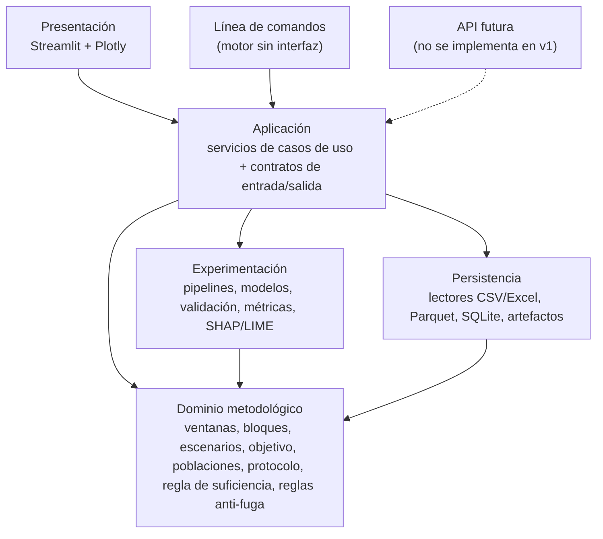
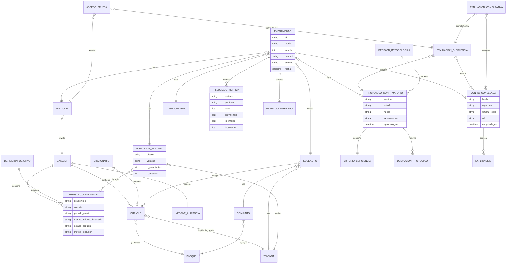
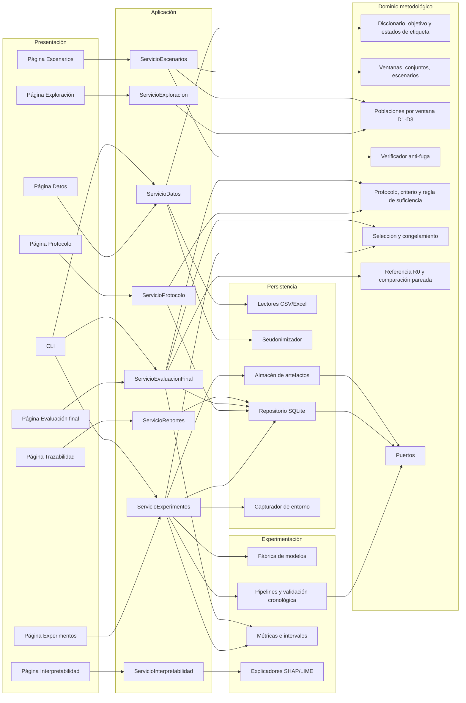
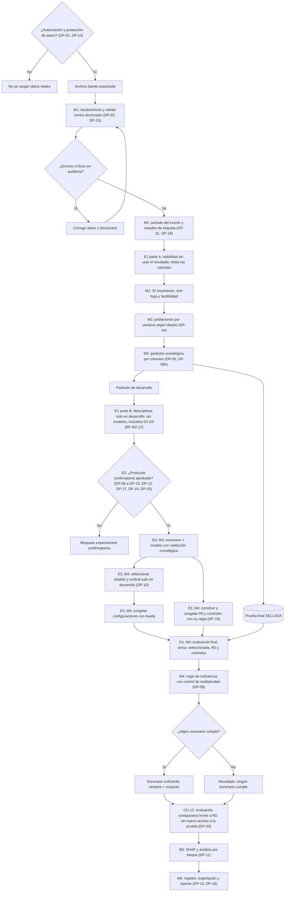

<!-- Copia de referencia de solo lectura, exportada el 2026-10-29 desde la revisión 240 del documento en línea.
     La versión vigente es el documento en línea; no editar esta copia: los cambios se hacen allí y se vuelve a exportar. -->

# Fase 1 — Especificación funcional y arquitectura de software

Método temporal para determinar la suficiencia de información en la detección temprana del riesgo de deserción académica

Oct 20, 2026 · @Javier

## 0. Control del documento

Esta especificación define qué hará la aplicación experimental y cómo se organizará el software. No contiene código, datos, métricas ni resultados, y no fija umbrales de suficiencia ni la definición institucional de deserción.

| Campo | Valor |
| --- | --- |
| Fase | 1 — Especificación funcional y arquitectura de software |
| Versión | 0.6 (cambio CP-08, responsables de los riesgos y decisiones del equipo del 29 de octubre de 2026, sección 14.5; la v0.5 se conserva en el historial del documento como revisión 182, la v0.4 como revisión 114, la v0.3 como revisión 79 y la v0.2 como revisión 46) |
| Estado | Borrador revisado, no aprobado formalmente: falta la conformidad de la asesoría. No existe todavía ningún protocolo, criterio de suficiencia ni definición de deserción aprobados |
| Artefacto científico | Método temporal de suficiencia de información |
| Artefacto de software | Aplicación web experimental local que ejecuta, evalúa y documenta el método |
| Cambios respecto de versiones anteriores | Sección 14 |

### Convención de clasificación

Cada requisito, componente y regla lleva una etiqueta de origen. Así se distingue lo que ya está decidido de lo que se propone y de lo que falta aprobar.

| Etiqueta | Significado | Cómo se modifica |
| --- | --- | --- |
| \[DEF\] | Definido por el contexto maestro del proyecto | Solo por decisión del equipo de investigación |
| \[REC\] | Recomendación técnica de esta especificación | Se acepta, modifica o rechaza al aprobar la Fase 1 |
| \[PEN\] | Decisión pendiente; remite a un código DP-xx de la sección 12 | Se resuelve con la asesoría y queda registrada |

La etiqueta DEF (rev. 0.2) marca lo que el equipo indicó como protección esencial en las instrucciones de revisión, como la validación cronológica. Sus detalles concretos siguen pendientes en la sección 12. La etiqueta DEF (rev. 0.3) marca los requisitos cuya incorporación el equipo autorizó en la revisión 0.3; autorizar un cambio no resuelve ninguna decisión pendiente asociada. La etiqueta DEF (rev. 0.5) marca los elementos de la evaluación comparativa cuya incorporación solicitó el equipo el 28 de octubre de 2026; sus opciones y valores siguen pendientes en DP-19 y DP-20.

Desde la v0.2 la prioridad se expresa por niveles y reemplaza a MoSCoW:

- **N1 — Núcleo del método:** sin esto no se puede demostrar el método ni proteger su validez.
- **N2 — Reproducibilidad y trazabilidad:** permite reconstruir y auditar cada resultado.
- **N3 — Complementario:** aporta valor, pero puede incorporarse después sin comprometer la contribución científica.

La clasificación completa está en la sección 2.3.

## 1. Visión y alcance

La aplicación permitirá ejecutar el método temporal de forma reproducible y auditable para responder en qué ventana (T0–T3) y con qué conjunto de información (A, F, S, B y sus combinaciones) se detecta el riesgo de deserción cumpliendo criterios previamente aprobados. \[DEF\]

### Problema

El proyecto plantea que la pregunta relevante para la detección temprana no es solo qué modelo predice mejor, sino cuándo la información acumulada es suficiente para detectar el riesgo con desempeño y confiabilidad aceptables. Por eso aborda la pregunta como un método, no como un modelo. La caracterización de cómo trata este punto la literatura corresponde al estado del arte de la tesis y no se afirma en esta especificación.

### Visión del producto

Una herramienta local que convierte el diseño de investigación en un flujo controlado: datos auditados, escenarios temporales sin fuga, experimentos registrados, un protocolo aprobado antes de los experimentos confirmatorios, una prueba final que se abre una sola vez y evidencia exportable para la tesis y el artículo.

### Evaluación comparativa del método

La aplicación compara la configuración que selecciona el método con una configuración de referencia convencional, que predice sin las reglas temporales e informativas del método. La comparación no presupone que el método obtenga mejores métricas: su finalidad es determinar si se puede predecir antes o con menos información sin perder más desempeño del que se considere aceptable. \[DEF (rev. 0.5)\]

| Concepto | Definición |
| --- | --- |
| A. Método propuesto | Procedimiento que construye y evalúa escenarios ventana × conjunto, aplica reglas de suficiencia definidas antes de ver resultados y determina si existe una combinación temporal e informativa aceptable. No es un algoritmo de clasificación |
| B. Configuración de referencia convencional (R0) | Predicción convencional que no usa las reglas de selección temporal e informativa del método: un escenario fijado de antemano y un modelo elegido por el criterio habitual de mejor desempeño en validación (sección 4, M4; DP-19) |
| C. Configuración seleccionada por el método | Ventana, conjunto de información y modelo que cumplen la regla de suficiencia durante el desarrollo, congelados antes de la evaluación final |
| D. Evaluación comparativa | Procedimiento que cuantifica, sobre los mismos estudiantes y con el mismo protocolo, las diferencias entre C y B en desempeño, momento de predicción e información necesaria (CU-12) |

Preguntas que responde la evaluación comparativa y dónde se responden:

| Pregunta | Análisis |
| --- | --- |
| 1. Desempeño de la configuración convencional | Métricas de R0 en la prueba (CMP-1) |
| 2. Desempeño de la configuración seleccionada | Métricas de la configuración seleccionada en la prueba (CMP-1) |
| 3. Proximidad suficiente al desempeño de referencia | Regla de no inferioridad frente a R0 (CMP-1) |
| 4. Predicción más temprana | Anticipación y cobertura temprana (CMP-3) |
| 5. Menos información necesaria | Reducción de bloques y variables (CMP-4) |
| 6. Respaldo estadístico y relevancia práctica | Intervalos de las diferencias, margen preespecificado y traducción a unidades operativas |
| 7. Evidencia de utilidad y límites de las conclusiones | Tabla de interpretación y limitaciones (sección 4, M4) |

### Interesados

| Rol | Interés | Uso de la aplicación |
| --- | --- | --- |
| Equipo de investigación (tesistas) | Ejecutar el método y obtener evidencia | Operador principal de todos los módulos |
| Asesoría académica | Validez metodológica y trazabilidad | Revisa decisiones, criterios y reportes |
| Unidad institucional proveedora de datos | Uso autorizado y protección de datos | Entrega datos; no opera la aplicación en v1 |
| Jurado o revisores | Reproducibilidad de los resultados | Consume reportes exportados |

### Dentro del alcance (versión 1)

- Importación y auditoría de datos desde CSV y Excel. \[DEF\]
- Construcción del objetivo a partir de reglas parametrizadas y aprobadas. \[DEF\]
- Construcción de 4 ventanas × 8 conjuntos = 32 escenarios, con control de fuga temporal y población elegible por ventana. \[DEF\]
- Soporte para un análisis complementario sobre población común, si se aprueba (DP-17). \[PEN\]
- Protocolo confirmatorio aprobado y congelado antes de los experimentos confirmatorios. \[DEF principio 4\]
- Entrenamiento y validación cronológica de 5 modelos candidatos por escenario. \[DEF\]
- Cálculo de métricas y aplicación de la regla de suficiencia aprobada sobre la prueba final reservada. \[DEF\]
- Explicaciones SHAP y LIME. \[DEF\]
- Registro de experimentos, exportación a CSV/Excel y reportes sin datos personales. \[DEF\]
- Ejecución del motor sin interfaz, mediante pruebas y una línea de comandos. \[REC\]

* Evaluación comparativa frente a una configuración de referencia convencional, preespecificada y congelada antes de la evaluación final. \[DEF (rev. 0.5)\]

### Fuera del alcance (versión 1)

- Alertas automáticas y decisiones institucionales sobre estudiantes. \[DEF\]
- Infraestructura cloud, servidores institucionales o servicios de pago. \[DEF\]
- Autenticación, multiusuario y base de datos central. \[DEF\]
- Integración en línea con sistemas académicos o CRM institucionales. \[REC\]
- Modelos fuera de los cinco candidatos (redes neuronales, AutoML). \[REC\]

* Comparación inferencial con modelos publicados cuya población, evento, horizonte, predictores o protocolo no puedan reproducirse con los datos del estudio; solo se discuten de forma descriptiva. \[REC\]
* Declarar superioridad del método sin una prueba preespecificada que la respalde. \[DEF (rev. 0.5)\]

### Supuestos

Ninguno de estos supuestos está confirmado. Cada uno se verifica en el análisis exploratorio de viabilidad (CU-11) o con la institución.

- Los datos llegan como archivos extraídos y autorizados, no por conexión directa. \[REC / PEN DP-02\]
- Existe un historial de matrícula por periodo y estudiante que permite fechar el evento de deserción. \[PEN DP-01, DP-15\]
- Cada variable puede asociarse a una fecha o ciclo a partir del cual está disponible. \[PEN DP-03\]
- Hay suficientes cohortes con seguimiento completo para reservar al menos una como prueba final cronológica. \[PEN DP-05\]
- La aplicación corre en un equipo personal con Python 3.11 o superior. \[REC\]

### Criterios de éxito del software

El éxito del software no depende de que algún escenario resulte suficiente: "ningún escenario cumple" es un resultado válido. Se mide por tres condiciones. Con la misma configuración, datos, semilla y entorno de dependencias bloqueado, los resultados se reproducen dentro de la tolerancia declarada. Cada resultado se vincula a su experimento y a la versión del protocolo. Ningún dato de prueba se usa antes de la evaluación final.

## 2. Requisitos

Se especifican 74 requisitos funcionales agrupados por módulo y 19 no funcionales. Los marcados PEN se implementarán como parámetros configurables, sin valores por defecto que sustituyan la decisión. La columna Nivel aplica la clasificación N1/N2/N3 de la sección 0.

### 2.1 Requisitos funcionales

**M1 — Preparación y auditoría de datos**

| Código | Requisito | Origen | Nivel |
| --- | --- | --- | --- |
| RF-M1-01 | Importar datos desde archivos CSV y Excel (.xlsx) | DEF | N1 |
| RF-M1-02 | Validar el archivo contra un diccionario de datos versionado: tipo, dominio, obligatoriedad y rol de cada columna | REC | N1 |
| RF-M1-03 | Generar un informe de auditoría: nulos, duplicados, rangos, cardinalidad y valores fuera de dominio, y verificar que cada registro tenga un estado de etiqueta válido. Antes del sellado, el informe no muestra la distribución de la clase ni la de los estados de etiqueta; ambas se reportan solo sobre la partición de desarrollo (RF-M2-09) | REC | N1 |
| RF-M1-04 | Excluir o seudonimizar identificadores directos antes de cualquier otro procesamiento | DEF | N1 |
| RF-M1-05 | Asignar cada variable a un bloque (A, F, S, B) y a una ventana mínima de disponibilidad desde el diccionario | DEF / PEN DP-03 | N1 |
| RF-M1-06 | Construir el objetivo con las reglas parametrizadas del desglose de DP-01: evento, población en riesgo, horizonte, fecha índice, pausas, transferencias y reingresos | DEF / PEN DP-01 | N1 |
| RF-M1-07 | Calcular y registrar la huella SHA-256 del archivo fuente y del dataset procesado | DEF | N2 |
| RF-M1-08 | Impedir el avance a M2 si la auditoría reporta errores críticos | REC | N1 |
| RF-M1-09 | Integrar varias tablas fuente (por bloque o por ciclo) mediante una clave seudonimizada | PEN DP-15 | N1 si DP-15 resulta en varias tablas |
| RF-M1-10 | Asignar a cada estudiante un estado de etiqueta (positivo, negativo o no etiquetable) con su motivo: seguimiento incompleto, resultado no observable o desenlace excluido. Si la proporción de no etiquetables de una cohorte supera el nivel que fije la asesoría en DP-18, exigir el análisis de sensibilidad que defina DP-18 (CP-08) | REC (REC-03 aceptada por el equipo con CP-08) / PEN DP-18 | N1 |
| RF-M1-11 | Derivar para cada estudiante el periodo del evento y el último periodo observado a partir del historial de matrícula | REC / PEN DP-01 | N1 |

**M2 — Ventanas temporales y conjuntos de información**

| Código | Requisito | Origen | Nivel |
| --- | --- | --- | --- |
| RF-M2-01 | Generar las ventanas T0, T1, T2 y T3 a partir de la ventana de disponibilidad de cada variable y de la fecha índice de cada ventana | DEF | N1 |
| RF-M2-02 | Generar los 8 conjuntos candidatos: A, A+F, A+S, A+B, A+F+S, A+F+B, A+S+B, A+F+S+B | DEF | N1 |
| RF-M2-03 | Construir la matriz de 32 escenarios y marcar como no factible todo escenario con un bloque sin variables disponibles en esa ventana | REC | N1 |
| RF-M2-04 | Verificar que ningún escenario incluya variables disponibles después de su fecha índice | DEF | N1 |
| RF-M2-05 | Construir la población elegible (conjunto en riesgo) de cada ventana según el diseño aprobado | DEF / PEN DP-04 | N1 |
| RF-M2-06 | Particionar en desarrollo y prueba final con criterio cronológico por cohortes y persistir los índices | DEF (rev. 0.2) / PEN DP-05 | N1 |
| RF-M2-07 | Sellar la partición de prueba: solo la operación de evaluación final puede leerla y cada acceso queda registrado | DEF | N1 |
| RF-M2-08 | Usar las mismas cohortes de prueba para todos los escenarios; dentro de ellas, cada ventana usa la población que define el diseño aprobado | REC | N1 |
| RF-M2-09 | Reportar por ventana: en la partición de desarrollo, población, eventos, prevalencia y excluidos por motivo, con la proporción de no etiquetables por cohorte y motivo (CP-08); en la partición de prueba, solo el tamaño hasta la evaluación final (E4) | REC | N1 |
| RF-M2-10 | Evaluar modelos sobre la población común entre ventanas cuando se apruebe el análisis complementario; su construcción descriptiva en desarrollo corresponde a RF-M2-12 | PEN DP-17 | N3 |
| RF-M2-11 | Calcular la cobertura temprana sobre la cohorte de admisión cuando se apruebe el análisis complementario | PEN DP-17 | N3 |
| RF-M2-12 | En E1 parte B (CU-11), calcular tamaño y eventos de las poblaciones D1, D2 y D3 por ventana, solo en la partición de desarrollo, sin entrenar modelos y sin esperar la aprobación de DP-17 | DEF (rev. 0.3) | N1 |

**M3 — Ejecución de modelos**

| Código | Requisito | Origen | Nivel |
| --- | --- | --- | --- |
| RF-M3-01 | Entrenar Logistic Regression, Random Forest, XGBoost, LightGBM y SVM por escenario | DEF | N1 |
| RF-M3-02 | Encapsular imputación, codificación, escalado, remuestreo y modelo en un pipeline ajustado solo con el entrenamiento de cada fold | DEF | N1 |
| RF-M3-03 | Ejecutar validación interna cronológica en la partición de desarrollo: cada fold de validación es posterior a su entrenamiento | DEF (rev. 0.2) / PEN DP-07 | N1 |
| RF-M3-04 | Ajustar hiperparámetros con el espacio y presupuesto declarados en el protocolo, iguales para cada algoritmo en todos los escenarios | PEN DP-07 | N1 |
| RF-M3-05 | Aplicar el tratamiento de desbalance dentro de cada fold | PEN DP-06 | N1 |
| RF-M3-06 | Fijar y registrar semillas en todos los componentes aleatorios | DEF | N1 |
| RF-M3-07 | Persistir cada modelo entrenado con su configuración y huellas de datos | DEF | N2 |
| RF-M3-08 | Ejecutar la matriz por lotes y omitir al reanudar las corridas ya completas | REC | N3 |
| RF-M3-09 | Calibrar probabilidades cuando la calibración esté aprobada | PEN DP-09 | N3 (N1 si DP-09 la incluye en el criterio) |
| RF-M3-10 | Tratar faltantes, incluidos los estructurales, según la regla aprobada | PEN DP-12 | N1 |
| RF-M3-11 | Registrar todas las corridas, incluidas las fallidas y las descartadas | REC | N2 |
| RF-M3-12 | Marcar cada experimento como exploratorio o confirmatorio; un experimento confirmatorio exige protocolo aprobado vigente | REC | N1 |

**M4 — Evaluación y suficiencia**

| Código | Requisito | Origen | Nivel |
| --- | --- | --- | --- |
| RF-M4-01 | Calcular Accuracy, Precision, Recall, F1-Score y ROC-AUC por escenario y modelo, junto con la prevalencia de la población evaluada | DEF | N1 |
| RF-M4-02 | Calcular Brier Score y curva de calibración cuando estén aprobados | PEN DP-09 | N3 (N1 si DP-09 los incluye en el criterio) |
| RF-M4-03 | Estimar intervalos de confianza de las métricas de las configuraciones congeladas | REC / PEN DP-08 | N1 |
| RF-M4-04 | Registrar el protocolo confirmatorio como objeto versionado (borrador, aprobado, reemplazado). Incluye criterios de suficiencia, control de multiplicidad, regla de selección de modelo y regla de umbral | DEF | N1 |
| RF-M4-05 | Rechazar experimentos confirmatorios y la evaluación final si no existe un protocolo aprobado vigente | DEF | N1 |
| RF-M4-06 | Aplicar la regla aprobada y devolver el escenario suficiente o el resultado "ningún escenario cumple" | DEF / PEN DP-08 | N1 |
| RF-M4-07 | Seleccionar el umbral de clasificación con predicciones de validación, nunca de prueba | DEF / PEN DP-06 | N1 |
| RF-M4-08 | Seleccionar el modelo representativo de cada escenario solo con datos de desarrollo, según la regla aprobada | PEN DP-10 | N1 |
| RF-M4-09 | Ejecutar la evaluación final una sola vez sobre configuraciones congeladas; una repetición exige justificación registrada | REC | N1 |
| RF-M4-10 | Comparar escenarios mediante tablas y gráficos por ventana y conjunto | REC | N2 |
| RF-M4-11 | Calcular métricas por subgrupo cuando se apruebe el análisis de equidad | PEN DP-13 | N3 |
| RF-M4-12 | Congelar cada configuración (algoritmo, hiperparámetros, preprocesamiento, variables, umbral, calibración, semilla y datos de reentrenamiento) con una huella que la evaluación final verifica | REC | N1 |
| RF-M4-13 | Registrar las desviaciones del protocolo con justificación y marcar los resultados afectados | REC | N2 |
| RF-M4-14 | Reportar los cinco modelos de cada escenario en validación, no solo el seleccionado | REC | N2 |
| RF-M4-15 | Construir la configuración de referencia convencional R0 con la regla preespecificada: mismas particiones, preprocesamiento, presupuesto de búsqueda y procedimiento de calibración que el método, sin compuerta de calibración, umbrales mínimos, no inferioridad ni reglas temporales o informativas | DEF (rev. 0.5) / PEN DP-19 | N1 |
| RF-M4-16 | Construir los referentes de control: R0 con la familia del modelo seleccionado (R0-fam), el conjunto más completo de la ventana seleccionada (R-ven) y, si se aprueba, el referente de maximización (R-max) | REC / PEN DP-19 | N1 (R-max: N3) |
| RF-M4-17 | Congelar R0 y los referentes de control con huella en E3, antes de abrir la prueba, y evaluarlos en el mismo acceso único que la configuración seleccionada | DEF (rev. 0.5) | N1 |
| RF-M4-18 | Calcular, sobre los mismos estudiantes de prueba, la diferencia pareada de cada métrica comparada entre la configuración seleccionada y cada referente, con su intervalo de incertidumbre | DEF (rev. 0.5) / PEN DP-20 | N1 |
| RF-M4-19 | Aplicar la regla de no inferioridad frente a R0 con las métricas, el margen y el nivel aprobados | DEF (rev. 0.5) / PEN DP-20 | N1 |
| RF-M4-20 | Calcular la anticipación (ventanas y ciclos de diferencia), la reducción de información (bloques y variables usados y evitados) y, si se aprueba, la cobertura temprana con la capacidad de alerta q | DEF (rev. 0.5) / PEN DP-20, DP-08i, DP-17 | N1 |
| RF-M4-21 | Verificar la validez de la comparación (mismo evento, horizonte, población comparada y cohortes de prueba) y clasificar el resultado en un estado de la tabla de interpretación, sin forzar una selección ni declarar superioridad no preespecificada | DEF (rev. 0.5) | N1 |
| RF-M4-22 | Reportar la estabilidad de la selección: frecuencia con que cada escenario cumple la regla por fold de desarrollo y métricas por cohorte de prueba, sin inferencia entre cohortes | REC / PEN DP-20 | N3 |

**M5 — Interpretabilidad**

| Código | Requisito | Origen | Nivel |
| --- | --- | --- | --- |
| RF-M5-01 | Generar explicaciones SHAP globales de los modelos congelados según el alcance aprobado | DEF / PEN DP-11 | N1 |
| RF-M5-02 | Generar explicaciones locales SHAP y LIME para registros seudonimizados | DEF | N3 |
| RF-M5-03 | Elegir el explicador SHAP según el modelo (árboles, lineal o kernel con muestra de fondo) | REC | N1 |
| RF-M5-04 | Agregar la importancia por bloque A, F, S y B | REC | N1 |
| RF-M5-05 | Registrar la partición, la muestra y la semilla usadas en cada explicación | REC | N2 |
| RF-M5-06 | Comparar la estabilidad de explicaciones entre semillas o folds | REC | N3 |

**M6 — Trazabilidad y reportes**

| Código | Requisito | Origen | Nivel |
| --- | --- | --- | --- |
| RF-M6-01 | Registrar cada experimento: identificador, modo, versión de protocolo, configuración, semillas, entorno, huella de datos, commit y resultados | DEF | N2 |
| RF-M6-02 | Consultar y comparar el historial de experimentos en la interfaz | REC | N3 |
| RF-M6-03 | Exportar resultados a CSV y Excel | DEF | N2 |
| RF-M6-04 | Generar reportes de experimento sin datos personales | DEF | N2 |
| RF-M6-05 | Llevar un registro de decisiones metodológicas con fecha, responsable y justificación | DEF | N2 |
| RF-M6-06 | Mostrar el registro de accesos a la partición de prueba | REC | N2 |
| RF-M6-07 | Generar el reporte comparativo: definición de R0 y de los controles, diferencias con intervalos, anticipación, reducción de información, estado del resultado y limitaciones | DEF (rev. 0.5) | N2 |

**Interfaz**

| Código | Requisito | Origen | Nivel |
| --- | --- | --- | --- |
| RF-UI-01 | Ofrecer una interfaz Streamlit con una página por módulo | DEF | N3 (se construye después del motor) |
| RF-UI-02 | Invocar exclusivamente servicios de aplicación; la interfaz no contiene lógica de ML | DEF | N2 (restricción permanente) |
| RF-UI-03 | Mostrar visualizaciones con Plotly | DEF | N3 |
| RF-UI-04 | Mostrar el estado de las decisiones pendientes y deshabilitar las funciones que dependen de ellas | REC | N3 |

### 2.2 Requisitos no funcionales

| Código | Categoría | Requisito | Origen |
| --- | --- | --- | --- |
| RNF-01 | Arquitectura | El dominio y el motor no importan Streamlit; se verifica con una prueba automática de dependencias | DEF |
| RNF-02 | Arquitectura | Todo caso de uso es ejecutable sin interfaz (pruebas y línea de comandos) | DEF |
| RNF-03 | Reproducibilidad | Con la misma configuración, datos, semillas y archivo de bloqueo de dependencias, las métricas se reproducen dentro de una tolerancia numérica declarada. No se promete identidad exacta entre sistemas operativos, hardware o versiones de bibliotecas | DEF / REC |
| RNF-04 | Privacidad | La ejecución es 100 % local; ninguna función envía datos a servicios externos | DEF |
| RNF-05 | Privacidad | Ningún identificador directo aparece en registros, reportes ni artefactos | DEF |
| RNF-06 | Privacidad | La telemetría de Streamlit queda desactivada en la configuración del proyecto | REC |
| RNF-07 | Seguridad | Los datos crudos y procesados quedan fuera del control de versiones | REC |
| RNF-08 | Seguridad | Los modelos serializados solo se cargan desde el espacio de trabajo propio y se verifican por huella | REC |
| RNF-09 | Trazabilidad | Todo resultado mostrado o exportado se vincula a un experimento y a una versión de protocolo | DEF |
| RNF-10 | Mantenibilidad | La configuración experimental es declarativa (YAML) y separada del código | REC |
| RNF-11 | Mantenibilidad | Código tipado, con linter y cobertura medida; la meta de cobertura se fija al aprobar la Fase 1 | REC |
| RNF-12 | Portabilidad | Funciona en Windows, Linux y macOS; la tolerancia de RNF-03 se verifica al menos en el sistema operativo de trabajo del equipo | REC |
| RNF-13 | Rendimiento | Los lotes largos muestran progreso; no se fija un tiempo máximo sin medir antes | REC |
| RNF-14 | Evolutividad | Los servicios de aplicación exponen contratos de entrada y salida reutilizables por una API futura | DEF |
| RNF-15 | Usabilidad | Mensajes de error y validación en español, con la causa y la acción sugerida | REC |
| RNF-16 | Integridad | Datos, particiones, protocolos y configuraciones congeladas se identifican por huella SHA-256 | REC |
| RNF-17 | Reproducibilidad | Cada experimento registra versión de Python, sistema operativo, huella del archivo de bloqueo y parámetros de paralelismo | REC |
| RNF-18 | Mantenibilidad | Toda dependencia nueva requiere una justificación registrada en la tabla de dependencias (sección 5.1) | REC |
| RNF-19 | Integridad de la evidencia | Todo resultado obtenido con datos sintéticos se rotula como tal en registros, gráficos y reportes, y no puede exportarse sin ese rótulo ni presentarse como evidencia de eficacia en una población real | DEF (rev. 0.5) |

### 2.3 Priorización por niveles

N2 no significa opcional. La trazabilidad no puede añadirse después a experimentos ya ejecutados, por lo que N1 y N2 se construyen juntos. N3 puede esperar.

| Nivel | Requisitos | Propósito |
| --- | --- | --- |
| N1 — Núcleo del método | RF-M1-01 a 06, 08, 10, 11 (y 09 según DP-15); RF-M2-01 a 09, 12; RF-M3-01 a 06, 10, 12; RF-M4-01, 03 a 09, 12, 15 a 21; RF-M5-01, 03, 04; RNF-01 a 07, 19 | Demostrar el método y proteger su validez |
| N2 — Reproducibilidad y trazabilidad | RF-M1-07; RF-M3-07, 11; RF-M4-10, 13, 14; RF-M5-05; RF-M6-01, 03 a 07; RF-UI-02; RNF-08 a 11, 14, 16 a 18 | Reconstruir y auditar cada resultado |
| N3 — Complementario | RF-M2-10, 11; RF-M3-08, 09; RF-M4-02, 11, 22 y el referente opcional R-max; RF-M5-02, 06; RF-M6-02; RF-UI-01, 03, 04; RNF-12, 13, 15 | Valor añadido que puede incorporarse después |

Protecciones que nunca se rebajan de nivel: anti-fuga (RF-M2-04), objetivo y estados de etiqueta (RF-M1-06, 10), validación cronológica (RF-M2-06, RF-M3-03), sellado de la prueba (RF-M2-07), protocolo aprobado (RF-M4-04, 05), privacidad (RF-M1-04, RNF-04, 05) y registro de experimentos (RF-M6-01).

**Funciones costosas o complejas que pueden posponerse**

| Función | Por qué es costosa | Qué se pierde al posponerla | Condición para incorporarla |
| --- | --- | --- | --- |
| Explicaciones locales SHAP y LIME (RF-M5-02) | LIME y KernelSHAP requieren muchas evaluaciones por registro | Ejemplos individuales; no afecta la regla de suficiencia | Motor N1 terminado |
| SHAP global sobre SVM | KernelSHAP es muy lento en SVM | Nada, si SVM no resulta seleccionado; si lo es, se usa una muestra de fondo acotada | Solo si DP-10 selecciona SVM |
| Estabilidad de explicaciones (RF-M5-06) | Repite explicaciones por semilla o fold | Evidencia de robustez interpretativa | Tras el análisis principal |
| Calibración y Brier (RF-M3-09, RF-M4-02) | Añade un ajuste y una métrica por configuración | Nada, salvo que DP-09 los incluya en el criterio; entonces pasan a N1 | DP-09 |
| Equidad por subgrupos (RF-M4-11) | Requiere atributos sensibles y análisis por grupo | Evidencia de sesgo. Es técnicamente posponible, pero se recomienda antes de cualquier uso institucional | DP-13 |
| Población común y cobertura temprana (RF-M2-10, 11) | Duplica evaluaciones | Separación entre efecto de la información y cambio de población. Si DP-17 la declara necesaria, pasa a N1 | DP-17 |
| Reanudación por lotes (RF-M3-08) | Gestión de estado de ejecución | Comodidad en corridas largas | Cuando el tiempo de ejecución lo justifique |
| Interfaz completa e historial comparativo (RF-UI-01, 03, 04; RF-M6-02) | Desarrollo de interfaz | Usabilidad; el método ya es ejecutable por CLI | Servicios N1 y N2 probados |

### 2.4 Matriz de trazabilidad

| Módulo | Requisitos | Casos de uso | Decisiones | Pruebas |
| --- | --- | --- | --- | --- |
| M1 | RF-M1-01 a 11 | CU-01, 02, 03, 11 | DP-01, 02, 03, 14, 15, 18 | PU-08, PU-09, PU-12, PU-14 a 17; PI-04, PI-14 |
| M2 | RF-M2-01 a 12 | CU-04, 11 | DP-03, 04, 05, 08h, 17 | PU-01, 02, 03, 10, 11, 12, 13, 18, 19; PI-02, 07, 08 |
| M3 | RF-M3-01 a 12 | CU-06 | DP-06, 07, 09, 12 | PU-05; PI-01, 03, 06, 08, 11, 12 |
| M4 | RF-M4-01 a 22 | CU-05, 07, 08, 12 | DP-06, 08, 08i, 09, 10, 13, 17, 19, 20 | PU-04, 05, 06, 07, 20, 22 a 27; PI-09, 10, 15 |
| M5 | RF-M5-01 a 06 | CU-09 | DP-11 | PU-21; PI-13 |
| M6 | RF-M6-01 a 07 | CU-10, 12 | DP-16 | PI-02, 03, 04, 12, 16 |
| Interfaz | RF-UI-01 a 04 | Todos | — | PIU-01; PA-01 |
| No funcionales | RNF-01 a 19 | — | — | PA-01 a 04; PI-04, 05, 11, 16 |

## 3. Casos de uso principales

Doce casos de uso cubren el ciclo completo del método y su evaluación comparativa. Hay dos actores humanos: el investigador, que opera, y el revisor metodológico (asesoría), que aprueba decisiones y el protocolo. En la versión 1 ambos usan el mismo equipo local; la aprobación se registra con nombre y fecha, no se autentica. \[REC\]

Los casos de uso se ejecutan en este orden: CU-01 → CU-02 → CU-03 → CU-11 (parte A) → CU-04 → CU-11 (parte B) → CU-05 → CU-06 → CU-07 → CU-08 → CU-12 → CU-09. CU-10 está disponible en todo momento.

| ID | Caso de uso | Actor | Precondición | Resultado | Requisitos |
| --- | --- | --- | --- | --- | --- |
| CU-01 | Importar y auditar un dataset | Investigador | DP-02 y DP-14 resueltas; archivo autorizado; diccionario disponible | Dataset seudonimizado y versionado; informe de auditoría sin distribución de la clase | RF-M1-01 a 04, 07, 08, 09 |
| CU-02 | Configurar el diccionario de variables | Investigador | DP-03 resuelta; DP-15 resuelta | Cada variable con rol, bloque y ventana de disponibilidad | RF-M1-05 |
| CU-03 | Construir el objetivo y los estados de etiqueta | Investigador | DP-01 y DP-18 aprobadas | Para cada estudiante: periodo del evento, último periodo observado y estado de etiqueta con motivo | RF-M1-06, 10, 11 |
| CU-11 | Ejecutar el análisis exploratorio de viabilidad | Investigador | Parte A: CU-03. Parte B: CU-04 | A: sobre todas las cohortes y sin usar el resultado (tamaños, completitud del seguimiento calculada con la cohorte, el horizonte y la fecha de corte, y disponibilidad de bloques; sin conteos de eventos ni de estados de etiqueta). B: solo en desarrollo (población, eventos, prevalencia, faltantes por ventana; tamaño y eventos de D1, D2 y D3 según RF-M2-12). Nunca desempeño comparado de modelos | RF-M2-09, 12 |
| CU-04 | Generar escenarios, poblaciones y particiones | Investigador | DP-04, DP-05 y DP-08h resueltas; CU-11 parte A completa | 32 escenarios con factibilidad, población por ventana y prueba final cronológica sellada | RF-M2-01 a 08 |
| CU-05 | Definir y aprobar el protocolo confirmatorio | Revisor metodológico | DP-06, 07, 08, 09, 10, 12, 17, 19 y 20 resueltas (y DP-13 si entra en el criterio); CU-11 parte B disponible | Protocolo versionado en estado aprobado, con huella, que incluye la regla de la referencia R0, los controles y el protocolo comparativo; desde ese momento es inmutable | RF-M4-04, 05 |
| CU-06 | Ejecutar experimentos de desarrollo | Investigador | Protocolo aprobado (CU-05) | Modelos y métricas de validación cronológica por escenario y modelo; todas las corridas registradas | RF-M3-01 a 12 |
| CU-07 | Seleccionar y congelar configuraciones | Investigador | CU-06 completo | Modelo representativo por escenario según la regla del protocolo; R0 y referentes de control construidos con su propia regla; todas las configuraciones congeladas con huella | RF-M4-01, 03, 07, 08, 10, 12, 14 a 17 |
| CU-08 | Ejecutar evaluación final y regla de suficiencia | Investigador con revisor | CU-07 completo; protocolo vigente | Métricas en prueba de la configuración seleccionada, de R0 y de los controles, obtenidas en el mismo acceso único; escenario suficiente o "ningún escenario cumple" | RF-M4-06, 09; RF-M2-07 |
| CU-12 | Ejecutar la evaluación comparativa frente a la referencia | Investigador con revisor | CU-08 completo; DP-19 y DP-20 incluidas en el protocolo aprobado | Validez de la comparación, diferencias pareadas con intervalos, no inferioridad frente a R0, anticipación, reducción de información, estabilidad y estado del resultado. Usa las predicciones de CU-08 y no vuelve a abrir la prueba | RF-M4-18 a 22; RF-M6-07; RNF-19 |
| CU-09 | Generar explicaciones | Investigador | CU-07 completo; DP-11 resuelta | Explicaciones SHAP globales y por bloque; locales si se habilitan | RF-M5-01 a 06 |
| CU-10 | Consultar trazabilidad y exportar reporte | Investigador o revisor | Al menos un registro | Historial, protocolos, desviaciones, decisiones, accesos a prueba y reporte sin datos personales | RF-M6-01 a 06; RF-M4-13 |

### Flujo detallado de CU-08 (caso crítico)

1. El investigador selecciona las configuraciones congeladas en CU-07.
2. El sistema verifica que exista un protocolo aprobado vigente y que su aprobación sea anterior al primer experimento confirmatorio. Si no, rechaza la operación.
3. El sistema verifica que cada configuración coincida con su huella de congelamiento.
4. El sistema abre la partición de prueba, registra el acceso con su motivo y evalúa cada configuración.
5. El sistema aplica la regla de suficiencia del protocolo, incluido su control de multiplicidad, y devuelve el escenario suficiente o declara que ninguno cumple.
6. El sistema guarda el resultado como evaluación de suficiencia vinculada al protocolo y a los experimentos.

Flujos alternativos:

- Una segunda evaluación final sobre la misma configuración exige justificación escrita y se registra como repetición. Nunca sobrescribe el resultado anterior.
- Si el protocolo se modificó después de iniciar los experimentos confirmatorios, el sistema exige registrar una desviación (RF-M4-13) y marca los resultados afectados.
- "Ningún escenario cumple" se reporta como resultado; no habilita cambiar los criterios para obtener uno favorable.

* La evaluación final incluye R0 y los referentes de control congelados. La evaluación comparativa (CU-12) se calcula con esas predicciones y no vuelve a abrir la prueba.

## 4. Módulos funcionales

Cada módulo es una responsabilidad funcional, no una carpeta. Sus piezas se reparten entre las capas de la sección 5: reglas en el dominio, orquestación en la aplicación, algoritmos en experimentación y archivos en persistencia. M2 y M4 incluyen las especificaciones metodológicas añadidas en la v0.2.

### M1 — Preparación y auditoría de datos

- **Responsabilidad:** convertir un archivo fuente autorizado en un dataset seudonimizado, validado, versionado y con estados de etiqueta construidos.
- **Entradas:** archivo CSV o Excel con historial de matrícula por periodo, diccionario de datos (YAML), definición del objetivo aprobada.
- **Salidas:** dataset procesado (Parquet), informe de auditoría, huellas SHA-256, periodo del evento, último periodo observado y estado de etiqueta por estudiante.
- **Componentes:** lector de archivos, validador de esquema, auditor de calidad, seudonimizador, integrador de tablas, constructor del objetivo y de estados de etiqueta.
- **Invariantes:** la seudonimización ocurre antes de cualquier otra transformación; el archivo original nunca se modifica; las columnas con rol identificador nunca pasan a M2; la distribución de la clase no se muestra antes del sellado de la prueba.
- **Decisiones pendientes:** DP-01, DP-02, DP-03, DP-14, DP-15, DP-18.

### M2 — Ventanas temporales y conjuntos de información

- **Responsabilidad:** traducir el diseño de investigación en escenarios ejecutables sin fuga temporal, con poblaciones definidas por ventana y una prueba final cronológica aislada.
- **Entradas:** dataset procesado, diccionario con bloque y ventana por variable, fechas índice, diseño de población aprobado, esquema de partición.
- **Salidas:** matriz de 32 escenarios con variables y factibilidad; población por ventana con sus conteos; índices de partición persistidos; prueba sellada.
- **Componentes:** catálogo de ventanas, generador de conjuntos, constructor de escenarios, verificador de fuga, constructor de conjuntos en riesgo (diseños D1, D2 y D3), particionador cronológico.
- **Invariantes:** una variable con ventana Tk solo entra en escenarios de ventana Tj con j ≥ k; todas las cohortes de prueba son posteriores a las de desarrollo; ningún componente ajusta parámetros con la prueba.
- **Decisiones pendientes:** DP-03, DP-04, DP-05, DP-08h, DP-17.

#### Comparabilidad temporal y población elegible

Las cuatro ventanas no observan la misma población. Quien deserta después del primer ciclo es un caso positivo en T0 y T1, pero ya no está en riesgo en T2. Por eso, una diferencia de desempeño entre T1 y T3 mezcla tres efectos: más información, una población distinta (quienes permanecen) y otra prevalencia del evento.

Definiciones: la **fecha índice** de Tk es el momento en que la información de esa ventana queda consolidada (DP-01). El **conjunto en riesgo** de Tk son los estudiantes de la cohorte que no presentaron el evento antes de esa fecha y cuya etiqueta es observable.

| Diseño | Población evaluada en Tk | Pregunta que responde | Ventajas | Sesgos y limitaciones | Requisitos de datos |
| --- | --- | --- | --- | --- | --- |
| D1 — Población elegible por ventana | El conjunto en riesgo de Tk | ¿Qué tan bien se detecta el riesgo en Tk entre quienes todavía pueden desertar? | Refleja el uso real; usa todos los casos observables; cada ventana evalúa a quien aún podría recibir apoyo | Población y prevalencia cambian entre ventanas; las ventanas tardías excluyen a los desertores tempranos; Precision, F1 y Accuracy no son directamente comparables | Periodo del evento y último periodo observado por estudiante |
| D2 — Población común | Solo quienes están en riesgo en la ventana más tardía, evaluados en todas las ventanas con el mismo evento | Con los mismos estudiantes y el mismo evento, ¿cuánto mejora la detección al acumular información? | Aísla mejor el efecto de la información | Excluye a los desertores tempranos, que son el foco de la detección temprana; el modelo T0 así entrenado no es el modelo T0 real; menos eventos e intervalos más amplios | Lo mismo que D1, y un horizonte cuyo evento ocurra después de la fecha índice de T3 |
| D3 — Cobertura sobre la cohorte de admisión | Toda la cohorte inicial; en Tk, quien ya desertó antes de la fecha índice cuenta como evento no detectado a tiempo | De todos los desertores, ¿qué proporción se detecta antes de que deserten si se evalúa en Tk? | Hace visible el costo de esperar y conecta suficiencia con oportunidad | No es una métrica de discriminación estándar; penaliza por construcción a las ventanas tardías; requiere un umbral congelado | Periodo del evento y umbral congelado por ventana |

Tratamiento de casos especiales:

| Situación | D1 | D2 | D3 |
| --- | --- | --- | --- |
| Deserta antes de la fecha índice de Tk | Excluido de Tk y de las ventanas posteriores; positivo en las anteriores | Excluido de todas las ventanas | Cuenta como evento no detectado en Tk |
| Deserta después de la fecha índice de Tk, dentro del horizonte | Positivo en Tk | Positivo solo si el evento es posterior a la fecha índice de T3 | Positivo detectable en Tk |
| Seguimiento incompleto para el horizonte (cohortes recientes) | No etiquetable: excluido de entrenamiento y evaluación, y contado por motivo | Igual que D1 | Igual que D1 |
| Resultado no observable (sin registros, traslado sin desenlace conocido) | No etiquetable según DP-01 y DP-18 | Igual que D1 | Igual que D1 |
| Desenlace excluido por la definición de DP-01 | Excluido y contado por motivo | Igual que D1 | Igual que D1 |

La exclusión de casos no etiquetables es la regla por defecto propuesta (REC-03, aceptada por el equipo el 29 de octubre de 2026 con el cambio CP-08 y pendiente de la conformidad de la asesoría) \[REC\], porque los cinco modelos candidatos requieren etiquetas binarias. Los métodos que aprovechan casos censurados (análisis de supervivencia) quedan fuera del alcance actual. Su sesgo conocido: si el seguimiento incompleto se concentra en las cohortes recientes, la exclusión reduce los datos más actuales. Por eso, las cohortes de prueba deben tener seguimiento completo. Por el cambio CP-08, la proporción de no etiquetables se reporta por cohorte y motivo (RF-M2-09) y, si en una cohorte supera el nivel que fije la asesoría, se exige un análisis de sensibilidad (RF-M1-10). La regla, ese nivel y el tipo de análisis de sensibilidad quedan pendientes en DP-18.

Consecuencia para las métricas: la prevalencia cambia entre ventanas en D1. Precision, F1 y Accuracy dependen de ella; ROC-AUC depende menos, pero sigue afectada por la composición de la población. El software reporta la prevalencia junto a cada métrica (RF-M4-01). Qué métrica gobierna la comparación entre ventanas se decide en DP-08.

Estado de la decisión: el diseño principal (DP-04) y la inclusión de D2 o D3 como complementarios (DP-17) quedan pendientes. Para decidir se necesita confirmar que existe el periodo del evento (CU-03) y conocer el tamaño de población y eventos por ventana en desarrollo (CU-11, parte B; RF-M2-12). El software implementa los tres diseños como esquemas configurables, de modo que la elección no obliga a rediseñar. Si solo se usa D1, la conclusión de la tesis se limita a "la población en riesgo en cada momento".

### M3 — Ejecución de modelos

- **Responsabilidad:** entrenar y validar cronológicamente los cinco modelos candidatos en cada escenario factible, de forma reproducible.
- **Entradas:** escenarios, partición de desarrollo, protocolo aprobado (modelos, espacios, presupuesto, desbalance, faltantes), semilla.
- **Salidas:** modelos entrenados, predicciones de validación fuera de fold, métricas por fold, registro de cada corrida.
- **Componentes:** fábrica de modelos, constructor de pipelines, validador cronológico, buscador de hiperparámetros, ejecutor por lotes.
- **Invariantes:** todo ajuste (imputación, escalado, codificación, remuestreo, calibración) ocurre dentro del pipeline y del fold; cada corrida tiene semilla y queda registrada, incluso si falla.
- **Decisiones pendientes:** DP-06, DP-07, DP-09, DP-12.

### M4 — Evaluación y suficiencia

- **Responsabilidad:** gestionar el protocolo confirmatorio, seleccionar y congelar configuraciones, medir el desempeño y aplicar la regla de suficiencia.
- **Entradas:** predicciones de validación y de prueba, protocolo aprobado, configuraciones congeladas.
- **Salidas:** tablas de métricas con prevalencia e intervalos, comparativos por escenario, configuraciones congeladas, evaluación de suficiencia con su justificación.
- **Componentes:** calculador de métricas, estimador de intervalos, gestor de protocolos y desviaciones, selector de modelo, congelador de configuraciones, motor de la regla de suficiencia, evaluador final, constructor de la referencia R0 y de los controles, comparador pareado.
- **Invariantes:** un protocolo aprobado es inmutable (un cambio crea una versión nueva y una desviación registrada); ningún experimento confirmatorio se ejecuta sin protocolo aprobado; la evaluación final solo acepta configuraciones cuya huella coincide.
- **Nota de diseño:** el motor de la regla recibe el criterio como datos. No contiene umbrales escritos en el código.
- **Decisiones pendientes:** DP-06, DP-08, DP-09, DP-10, DP-13, DP-19, DP-20.

#### Protocolo en cuatro etapas

La v0.1 tenía una inconsistencia: el flujo ubicaba la aprobación del criterio después de comparar escenarios en validación, mientras el texto recomendaba aprobarlo antes de M3. La v0.2 la resuelve así: el protocolo aprobado es precondición de todo experimento confirmatorio y, por tanto, también de la evaluación final.

| Etapa | Qué se permite | Qué no se permite | Datos | Caso de uso |
| --- | --- | --- | --- | --- |
| E1 — Exploración de viabilidad | Parte A: describir cohortes, completitud del seguimiento (según cohorte, horizonte y fecha de corte) y disponibilidad de variables sin usar el resultado. Parte B: describir población, eventos, prevalencia y faltantes por ventana, incluidas las poblaciones D1, D2 y D3 (RF-M2-12). Verificar el pipeline con datos sintéticos | Entrenar modelos con datos reales para comparar escenarios; mirar la prueba | A: todas las cohortes. B: solo desarrollo, tras el sellado | CU-11 |
| E2 — Protocolo confirmatorio | Fijar diseño de población, métricas primaria y secundarias, criterios de suficiencia, control de multiplicidad, regla de selección, regla de umbral, espacios y presupuesto de búsqueda, faltantes, desbalance y calibración, y la regla de la referencia R0, los controles y el protocolo comparativo (DP-19, DP-20). Aprobar y congelar con huella | Fijar umbrales a partir de desempeño observado en datos reales | Ninguno nuevo | CU-05 |
| E3 — Desarrollo | Entrenar, validar cronológicamente, seleccionar y congelar según el protocolo | Cambiar el protocolo sin registrar una desviación; usar la prueba | Solo desarrollo | CU-06, CU-07 |
| E4 — Evaluación final | Evaluar una vez las configuraciones congeladas, incluidas R0 y los controles, aplicar la regla y después la evaluación comparativa (CU-12) sin nuevo acceso | Reajustar modelos, umbrales o criterios | Prueba sellada | CU-08 |

Si el equipo considera imprescindible un piloto con desempeño real antes de E2, solo podría hacerse con cohortes que después se excluyan del análisis confirmatorio, y debe registrarse como decisión. Esta posibilidad corresponde a DP-08h, que se resuelve junto con DP-05 antes de CU-04 (sección 12.2).

#### Selección del modelo representativo de cada escenario

La estrategia propuesta \[REC, pendiente en DP-07 y DP-10\] usa solo la partición de desarrollo:

1. Para cada escenario y algoritmo, los hiperparámetros se ajustan dentro de los folds de entrenamiento y el desempeño se estima en folds de validación posteriores (validación cronológica anidada o una cohorte de validación posterior, según DP-07).
2. La métrica de selección es la métrica primaria del protocolo, calculada sobre predicciones de validación fuera de fold. La regla de desempate (por ejemplo, preferir el modelo más simple dentro de un margen predeclarado) se fija en DP-10, sin valores en este documento.
3. El umbral se elige con las predicciones de validación del modelo seleccionado, según la regla del protocolo.
4. La configuración seleccionada se reentrena o no sobre toda la partición de desarrollo, según DP-10, y se congela con su huella (RF-M4-12).

Comparación justa entre ventanas y conjuntos: todos los escenarios usan las mismas cohortes por fold, los mismos algoritmos, espacios de búsqueda, presupuesto, preprocesamiento y regla de umbral. Entre escenarios solo cambian la ventana y el conjunto de variables. Como análisis complementario, se reportan los cinco modelos de cada escenario (RF-M4-14), lo que permite comparar también con un algoritmo fijo y separar el efecto de la información del efecto de elegir algoritmo.

Control del sesgo de selección: el máximo de muchas puntuaciones de validación es optimista, por lo que esas puntuaciones no se reportan como estimación final; la estimación final proviene de la prueba sellada. Se registra cuántas configuraciones se evaluaron (RF-M3-11). La multiplicidad al aplicar la regla sobre varios escenarios en prueba se controla con la opción que se apruebe en DP-08.

La partición de prueba nunca se usa para seleccionar modelos, hiperparámetros, umbrales, calibración ni criterios. Lo garantizan el sellado (RF-M2-07) y la prueba PI-10.

#### Evaluación comparativa frente a la referencia convencional

La referencia recomendada es interna y preespecificada: predice con toda la información de una ventana fijada de antemano y elige el modelo por el criterio convencional de mejor desempeño en validación. Es una recomendación técnica pendiente de aprobación (DP-19). La comparación con estudios publicados queda como discusión descriptiva, salvo que se cumplan los requisitos de reproducción. \[DEF (rev. 0.5) / PEN DP-19, DP-20\]

**Alternativas analizadas**

| Alternativa | Ventajas | Limitaciones | Requisitos | Valoración |
| --- | --- | --- | --- | --- |
| 1. Configuración convencional fija (ventana, conjunto y familia definidos de antemano) | Simple; no hay selección; fácil de preespecificar | La elección puede ser arbitraria o favorecer al método. Si la familia difiere de la seleccionada por el método, mezcla el efecto del algoritmo | Justificar la configuración antes de ver datos | Útil como control (R0-fam), no como referencia principal |
| 2. Modelo de la literatura | Conecta con el estado del arte | Suele usar otra población, otra definición de deserción, otro horizonte o predictores sin la misma disponibilidad temporal. Sin especificación completa no es reproducible, y comparar cifras publicadas no es una comparación pareada | Mismo evento, horizonte, población y predictores con igual disponibilidad; especificación o modelo completo; datos para aplicarlo | Solo comparación externa descriptiva, salvo que se cumplan todos los requisitos (DP-19e) |
| 3. Configuración convencional con protocolo independiente | Representa la práctica habitual: toda la información y el mejor modelo en validación. Se evalúa con los mismos estudiantes y el mismo protocolo, en forma pareada | Si también el escenario se eligiera por desempeño, la referencia sería optimista. Su ventana determina qué estudiantes pueden compararse | Escenario fijado por una regla que no use desempeño; misma búsqueda y calibración que el método | **Recomendada** como referencia principal, con el escenario fijado por regla |

**Referencia principal y controles**

| Código | Escenario | Selección del modelo | Qué aísla | Decisión |
| --- | --- | --- | --- | --- |
| R0 | Ventana de referencia t\_ref con su conjunto más completo. Recomendación: t\_ref = ventana evaluable más tardía, fijada con los conteos de eventos de desarrollo antes de modelar. Alternativa: la ventana en la que la institución decide hoy, si existe | Familia con mayor AUC-ROC en validación entre las cinco, con el mismo presupuesto, preprocesamiento y paso de calibración; sin compuerta, umbrales mínimos ni no inferioridad; empates con el orden de familias del protocolo | El valor conjunto de las reglas del método: momento, información y modelo | DP-19a a c |
| R0-fam | El de R0 | La misma familia que el modelo seleccionado por el método | Anticipación e información con el algoritmo constante | DP-19d |
| R-ven | Ventana seleccionada t\* con su conjunto más completo; solo si el conjunto seleccionado no es ya el más completo | La regla de R0 | Reducción de información con el momento y la población constantes | DP-19d |
| R-max | Escenario y familia con mayor AUC-ROC en validación entre todos los escenarios evaluables | La regla de R0 | Qué elegiría una selección que solo maximiza desempeño. Descriptivo y optimista por construcción | DP-19d, opcional (N3) |

Relación con la regla de suficiencia: según la versión congelada del manuscrito (23 de octubre de 2026), la regla propuesta ya compara cada escenario con el conjunto más completo de su ventana y de cada ventana posterior evaluable (DP-08d). R0 no reemplaza esos comparadores ni forma parte de la regla. Es una referencia externa, elegida con el criterio convencional, que se evalúa en la prueba. Si se adopta la recomendación de t\_ref, su escenario coincide con el del comparador de la ventana más tardía, pero su modelo puede ser distinto porque no pasa por la compuerta de calibración. Todos los referentes salen de modelos que el desarrollo ya entrena: solo añaden su congelamiento y su evaluación final.

**Controles experimentales**

| Control | Cómo se garantiza |
| --- | --- |
| Mismo evento y horizonte | Una sola definición aprobada (DP-01); RF-M4-21 rechaza la comparación si difieren |
| Misma población y mismo conjunto de prueba | CMP-1 usa solo estudiantes de las cohortes de prueba en riesgo en t\_ref, que por el anidamiento también están en riesgo en t\*; RF-M4-21 lo verifica |
| Referencia fijada antes de la prueba | La regla de R0 forma parte del protocolo aprobado (CU-05); R0 se congela en E3 (RF-M4-17) |
| Selección, ajuste, transformaciones y calibración solo con desarrollo | Mismo pipeline y misma partición que el método (RF-M3-02, RF-M4-15) |
| Sin fuga temporal | Mismo verificador anti-fuga (RF-M2-04): R0 solo usa variables disponibles en t\_ref |
| Prueba sellada hasta definir todo | RF-M2-07 y RF-M4-17: un solo acceso para todas las configuraciones |
| Mismo protocolo de evaluación | Mismas métricas, el mismo método de incertidumbre y las mismas predicciones de prueba |
| Registro completo | RF-M6-01 y RF-M6-07: datos, configuraciones, semillas, modelos, métricas y decisiones |
| Sin elección retrospectiva de la referencia | La regla de R0 se aprueba antes de E3; cualquier cambio posterior es una desviación visible (RF-M4-13) |
| Datos sintéticos no son evidencia | RNF-19: rótulo obligatorio; los resultados sintéticos solo prueban el software |

**Comparaciones**

| ID | Pregunta | Configuraciones | Población | Carácter |
| --- | --- | --- | --- | --- |
| CMP-1 | 1, 2, 3 y 6 | Seleccionada frente a R0 | Estudiantes de prueba en riesgo en t\_ref | Confirmatoria si DP-20 la aprueba; si no, descriptiva |
| CMP-2 | Separar el efecto del algoritmo y de la información | Seleccionada frente a R0-fam y frente a R-ven | La común a cada par | Descriptiva |
| CMP-3 | 4 | Diferencia en ventanas y ciclos; cobertura temprana con capacidad q: proporción de desertores en riesgo en t\* que reciben alerta antes de su evento | Estudiantes de prueba en riesgo en t\* (lógica del diseño D3) | Descriptiva; requiere q (DP-08i) y D3 (DP-17) |
| CMP-4 | 5 | Bloques y variables usados y evitados | — | Descriptiva (exacta, sin incertidumbre) |
| CMP-5 | Estabilidad | Frecuencia de cumplimiento de la regla por fold de desarrollo; métricas por cohorte de prueba | — | Descriptiva |

CMP-1 excluye a quienes desertan entre t\* y t\_ref, que son precisamente los que solo la predicción temprana puede alcanzar. Por eso CMP-1 mide el costo en desempeño para los estudiantes observables en ambos momentos, y CMP-3 mide el beneficio de anticipar. Ninguna de las dos mide sola el valor del método. Una diferencia de métricas entre poblaciones distintas no es un efecto del método.

**Métricas**

| Métrica | Qué compara | Interpretación de la diferencia | Limitaciones |
| --- | --- | --- | --- |
| AUC-ROC | Capacidad de ordenar a los estudiantes por riesgo, sin umbral | Positiva favorece a la configuración seleccionada | No mide calibración ni utilidad con capacidad limitada; depende de la composición de la población |
| Brier escalado (si DP-09 lo aprueba) | Calidad de las probabilidades respecto de la prevalencia | Positiva favorece a la seleccionada; exige la misma población, que CMP-1 cumple | Frente a una referencia mal calibrada no informa sobre calidad probabilística: si R0 no pasa la compuerta, se reporta sin sostener conclusiones probabilísticas |
| Recall@q (si se fija q, DP-08i) | Proporción de desertores alcanzados con la capacidad de alerta | Unidad operativa: diferencia × eventos = estudiantes alcanzados de más o de menos | Su máximo depende de la prevalencia; requiere que la institución fije q |
| Precision, Recall, F1 y Accuracy | Clasificación con el umbral del protocolo | Complementarias | Dependen del umbral y de la prevalencia; la Accuracy es engañosa con desbalance; no son objeto de no inferioridad salvo decisión expresa |
| Intercepto y pendiente de calibración (si se aprueban) | Confiabilidad de las probabilidades | Descriptivas o compuerta | Inestables con pocos eventos |

Las métricas primarias siguen pendientes en DP-08a. La versión congelada del manuscrito propone AUC-ROC, Brier escalado y Recall@q con compuerta de calibración, sin valores aprobados.

**Incertidumbre y pruebas**

- Las comparaciones son pareadas: ambas configuraciones predicen a los mismos estudiantes. Recomendación: bootstrap pareado que remuestrea estudiantes estratificando por cohorte × resultado (propuesta del manuscrito) y recalcula la métrica de ambas configuraciones en cada réplica.
- Ese bootstrap no captura la variabilidad por reentrenamiento ni la variación entre cohortes. Con una o dos cohortes de prueba no es posible un bootstrap por conglomerados de cohorte; las diferencias por cohorte se reportan solo como descripción.
- DeLong pareado para AUC-ROC, como análisis de sensibilidad, solo si se comprueban sus supuestos (estudiantes independientes, tratamiento de empates). No aplica al Brier escalado ni a Recall@q.
- No se fija ninguna otra prueba estadística sin comprobar antes sus supuestos y el diseño.
- Multiplicidad, recomendación: secuencia fija preespecificada. Primero, la confirmación de la suficiencia del método (DP-08f); después, la no inferioridad frente a R0 en CMP-1, con prueba de intersección-unión sobre las métricas aprobadas; por último, superioridad, solo si se preespecifica. CMP-2 a CMP-5 son descriptivas.

**Regla de no inferioridad frente a R0** (recomendación, pendiente en DP-20)

- **Métricas:** las primarias aprobadas en DP-08a. Todas deben cumplir la condición (intersección-unión).
- **Diferencia:** Δ\_k = métrica\_k(seleccionada) − métrica\_k(R0), orientada para que un valor mayor sea mejor. El Brier escalado ya cumple esa orientación.
- **Margen:** δ\_k^R por métrica, fijado antes de E3. Recomendación: igual al margen δ\_k de la regla del método, salvo justificación, para que la comparación externa no sea más laxa que la regla. Sin valor.
- **Resultado favorable:** el límite inferior del intervalo unilateral (1 − α) de Δ\_k supera −δ\_k^R en cada métrica. α y el número de réplicas son los del protocolo (DP-08e).
- **Resultado no concluyente:** si el intervalo incluye −δ\_k^R, la no inferioridad no está demostrada. No se declara inferioridad.
- **Pérdida mayor que el margen:** si todo el intervalo bilateral queda por debajo de −δ\_k^R.
- **Nunca** se interpreta la falta de significación de una diferencia como equivalencia o no inferioridad.
- **Superioridad:** solo con una prueba preespecificada, después de demostrar la no inferioridad.

**Interpretación de resultados**

El sistema reporta el estado que respalda la evidencia. Nunca fuerza una selección ni declara una superioridad no demostrada.

| Estado | Condición | Qué se reporta | Qué no puede afirmarse |
| --- | --- | --- | --- |
| C1. Suficiente y no inferior a R0 | Suficiencia confirmada en la prueba y no inferioridad demostrada en todas las métricas | Diferencias con intervalos, anticipación y reducción de información | Que supera a R0; que se generaliza a otras instituciones |
| C2. Anticipación respaldada | C1 con t\* anterior a t\_ref | Además, ventanas y ciclos ganados y cobertura temprana | Que alertar antes reduce la deserción |
| C3. Suficiente, no inferioridad no demostrada | El intervalo de alguna métrica incluye −δ\_k^R | Diferencias, intervalos y, si corresponde, precisión limitada | Que es inferior o que es equivalente |
| C4. Pérdida mayor que el margen | El intervalo de alguna métrica queda entero por debajo de −δ\_k^R | Magnitud de la pérdida | Que el método fallaría con otros datos |
| C5. Ninguna configuración suficiente | La regla no selecciona ninguna | Desempeño de R0 y de los escenarios, descriptivo | Que la información no sirve; que R0 es suficiente, pues no se evaluó con la regla |
| C6. Indeterminado | Ventana no evaluable, comparador faltante o precisión insuficiente para concluir | Qué falta y por qué | Cualquier conclusión comparativa |
| C7. Comparación no válida | Difieren evento, horizonte, población o cohortes, o R0 no es evaluable | El motivo | Diferencias de métricas como efecto del método |
| C8. Sin ganancia | La configuración seleccionada usa el escenario de R0 | Diferencia nula en tiempo e información | Una ventaja del método en estos datos |

Si la configuración seleccionada no se confirma en la prueba (estado "no confirmable" del manuscrito), se informa como hallazgo, no se elige otra y la comparación con R0 se reporta solo como descripción.

**Limitaciones del diseño comparativo**

- R0 es una referencia interna de una sola institución, no "el estado del arte".
- La ventana más tardía puede tener pocos eventos; por eso t\_ref se define como la ventana evaluable más tardía, fijada antes de modelar.
- La incertidumbre no incluye el reentrenamiento ni la variación entre cohortes.
- CMP-3 depende de que se aprueben q y el diseño D3.
- La comparación no demuestra que alertar antes cause menos deserción.
- Con datos sintéticos solo se prueba el software, nunca la eficacia del método.

### M5 — Interpretabilidad

- **Responsabilidad:** explicar qué variables y qué bloques sostienen las predicciones de los modelos congelados.
- **Entradas:** modelo congelado, partición declarada, muestra de fondo para SHAP.
- **Salidas:** importancias globales, importancia agregada por bloque y, si se habilitan, explicaciones locales seudonimizadas.
- **Componentes:** selector de explicador SHAP, adaptador LIME, agregador por bloque, analizador de estabilidad.
- **Invariantes:** las explicaciones se presentan como asociaciones del modelo, no como causas; cada explicación registra partición, muestra y semilla; solo se explican modelos congelados.
- **Decisiones pendientes:** DP-11.

### M6 — Trazabilidad y reportes

- **Responsabilidad:** garantizar que cada resultado pueda reconstruirse y auditarse, y producir los entregables exportables.
- **Entradas:** eventos de todos los módulos.
- **Salidas:** registro de experimentos, protocolos y desviaciones, decisiones, accesos a prueba, exportaciones CSV/Excel y reportes.
- **Componentes:** repositorio de experimentos, capturador de entorno (versiones, commit, sistema, archivo de bloqueo), registro de decisiones, generador de reportes, exportador.
- **Invariantes:** los registros solo se agregan, no se editan; los reportes pasan por un filtro que bloquea columnas con rol identificador.
- **Decisiones pendientes:** DP-16.

## 5. Arquitectura lógica por capas

Se propone un monolito modular de cinco capas con dependencias en un solo sentido, hacia el dominio. \[REC\] El dominio define interfaces (puertos) que experimentación y persistencia implementan; así la interfaz y una futura API usan los mismos servicios sin tocar los algoritmos.



| Capa | Responsabilidad | Puede depender de | No puede depender de | Bibliotecas |
| --- | --- | --- | --- | --- |
| Presentación | Capturar parámetros, mostrar estado, resultados y gráficos | Aplicación | Dominio, experimentación, persistencia | Streamlit, Plotly |
| Aplicación | Orquestar casos de uso, validar precondiciones y decisiones pendientes, registrar trazas | Dominio y los puertos | Streamlit | pydantic |
| Dominio metodológico | Conceptos y reglas del método, sin entrada/salida | Nada externo salvo pandas y NumPy | Streamlit, scikit-learn, SQLite, archivos | pandas, NumPy |
| Experimentación | Implementar entrenamiento, validación, métricas y explicaciones | Dominio | Presentación, aplicación | scikit-learn, XGBoost, LightGBM, SHAP, LIME |
| Persistencia | Leer y escribir datos, artefactos y registros | Dominio | Presentación, aplicación, experimentación | pandas, pyarrow, openpyxl, sqlite3, joblib |

### Reglas de diseño

- **Puertos en el dominio:** interfaces como `RepositorioExperimentos`, `AlmacenArtefactos`, `EntrenadorModelos` y `Explicador`. Las capas externas las implementan. \[REC\]
- **Contratos de aplicación:** cada servicio recibe y devuelve objetos tipados (pydantic). Son la superficie que una API futura expondrá tal cual. \[REC\]
- **Configuración como datos:** ventanas, conjuntos, modelos y protocolos viven en YAML versionado, no en el código. \[REC\]
- **Interfaz delgada:** cada página de Streamlit llama a un servicio y muestra su respuesta. Los cálculos pesados se ejecutan en servicios y se guardan; la interfaz lee resultados guardados en lugar de recalcularlos en cada interacción. \[REC\]
- **Verificación automática:** un contrato de dependencias (import-linter) falla la batería de pruebas si una capa importa otra no permitida. \[REC\]

La capa de experimentación existe separada del dominio por una razón: el método (qué es un escenario, cuándo hay suficiencia) es estable, mientras que las bibliotecas de ML cambian de versión con frecuencia. Separarlas permite probar la regla de suficiencia con resultados sintéticos sin entrenar ningún modelo.

### 5.1 Dependencias tecnológicas

La versión 1 usa 14 dependencias de ejecución además de Python, 4 condicionales y 6 de desarrollo; ninguna requiere servidor, cloud ni licencia de pago. Las versiones exactas se fijan en el archivo de bloqueo durante la implementación, no en esta especificación.

| Dependencia | Función | Capa | Justificación | Tipo |
| --- | --- | --- | --- | --- |
| Python 3.11+ | Lenguaje | Todas | Compatibilidad amplia con las bibliotecas de ML y XAI | Ejecución |
| pandas, NumPy | Datos tabulares y numéricos | Dominio, experimentación, persistencia | Base del procesamiento \[DEF\] | Ejecución |
| pyarrow | Lectura y escritura Parquet | Persistencia | Conserva tipos (fechas, códigos con ceros) que CSV pierde | Ejecución |
| openpyxl | Lectura y escritura .xlsx | Persistencia | Motor de Excel para pandas \[DEF importación/exportación\] | Ejecución |
| scikit-learn | Pipelines, LR, RF, SVM, validación, métricas, calibración | Experimentación | Cubre tres de los cinco modelos y todo el preprocesamiento \[DEF\] | Ejecución |
| XGBoost, LightGBM | Modelos candidatos | Experimentación | Exigidos por el diseño \[DEF\] | Ejecución |
| SHAP, LIME | Interpretabilidad | Experimentación | Exigidos por el diseño \[DEF\] | Ejecución |
| Streamlit | Interfaz local | Presentación | Exigida por el diseño \[DEF\] | Ejecución |
| Plotly | Gráficos | Presentación | Exigida por el diseño \[DEF\] | Ejecución |
| pydantic | Contratos de los servicios | Aplicación | Valida entradas y es el formato que usaría una API futura | Ejecución |
| PyYAML | Configuración declarativa | Persistencia | Lee protocolos y escenarios versionados | Ejecución |
| joblib | Serialización de modelos | Persistencia | Ya incluida con scikit-learn | Ejecución |
| sqlite3 | Registro de experimentos | Persistencia | Biblioteca estándar de Python, sin instalación (DP-16 decidida por el equipo: SQLite) | Condicional (DP-16) |
| imbalanced-learn | Remuestreo dentro del fold | Experimentación | Solo si DP-06 elige remuestreo | Condicional |
| Optuna | Búsqueda bayesiana | Experimentación | Solo si DP-07 la elige; la búsqueda en malla o aleatoria de scikit-learn no la necesita | Condicional |
| pip-tools | Generar el archivo de bloqueo | Desarrollo del entorno | Fija versiones exactas para RNF-03 | Condicional (puede sustituirse por `pip freeze`) |
| pytest, pytest-cov, hypothesis | Pruebas y cobertura | Pruebas | Estrategia de la sección 9 | Desarrollo |
| import-linter | Contratos entre capas | Pruebas | Verifica RNF-01 | Desarrollo |
| ruff, mypy | Estilo y tipos | Calidad | RNF-11 | Desarrollo |

La línea de comandos usa `argparse` de la biblioteca estándar, sin dependencia adicional. Quedan descartadas en la versión 1: FastAPI y SQLAlchemy (etapas E2 y E3), MLflow y DVC (registro y versionado externos), Docker, colas de trabajo y cualquier servicio en línea. Una dependencia nueva requiere agregar una fila a esta tabla (RNF-18).

### 5.2 Alcance de la reproducibilidad

La reproducibilidad se comprueba dentro de tolerancias declaradas y bajo un entorno de dependencias controlado. No se promete identidad exacta de resultados entre todos los sistemas y versiones.

| Situación | Qué se garantiza | Cómo se verifica |
| --- | --- | --- |
| Mismo equipo, mismo archivo de bloqueo, mismas semillas y configuración | Métricas dentro de la tolerancia declarada | Prueba PI-11 en cada cierre de fase |
| Otro sistema operativo o hardware, mismo archivo de bloqueo | Métricas dentro de la tolerancia declarada, si se verificó en ese sistema | PI-11 ejecutada en ese sistema |
| Versiones distintas de bibliotecas | Ninguna garantía | Reejecutar y registrar el nuevo entorno |

Fuentes conocidas de variación: paralelismo en modelos de árboles, orden de operaciones de punto flotante y cambios internos entre versiones. Se mitigan fijando semillas y el número de hilos, y activando las opciones de determinismo de cada biblioteca cuando existan. El valor de la tolerancia se fija después de medir la variación real en la fase de implementación y se registra en `config/proyecto.yaml`; este documento no lo define.

## 6. Estructura del repositorio

El código se organiza por capa en un paquete instalable llamado `suficiencia`, con los módulos M1–M6 como subcarpetas dentro de cada capa. \[REC\] Datos y resultados quedan fuera del control de versiones.

```text
suficiencia-desercion/
├── pyproject.toml              # metadatos, dependencias, herramientas (ruff, mypy, pytest)
├── requirements.lock           # versiones exactas para reproducir el entorno
├── README.md
├── .gitignore                  # excluye data/, workspace/, reports/generados
├── .streamlit/config.toml      # telemetría desactivada, tema
├── .importlinter               # contratos de dependencias entre capas
├── config/
│   ├── proyecto.yaml           # rutas, semilla global, tolerancias
│   ├── escenarios.yaml         # ventanas T0–T3, bloques, 8 conjuntos
│   ├── modelos.yaml            # 5 modelos y espacios de búsqueda (PEN DP-07)
│   ├── diccionario/            # diccionarios de variables versionados (PEN DP-03)
│   ├── objetivo/               # definiciones de deserción versionadas (PEN DP-01)
│   └── protocolo/              # protocolos confirmatorios; vacío hasta aprobación (PEN DP-08)
├── data/                       # NO versionado
│   ├── raw/                    # archivos fuente, solo lectura
│   ├── interim/                # seudonimizados
│   └── processed/              # datasets listos para M2
├── workspace/                  # NO versionado
│   ├── registro.sqlite         # experimentos, decisiones, accesos (PEN DP-16)
│   ├── particiones/            # índices de partición y sello de prueba
│   └── experimentos/<id>/      # config, métricas, modelo, explicaciones
├── reports/                    # reportes exportados, sin datos personales
├── docs/
│   ├── especificacion/         # este documento
│   ├── decisiones/             # registro de decisiones (DP-xx y ADR)
│   └── diagramas/              # fuentes Mermaid
├── src/suficiencia/
│   ├── domain/
│   │   ├── datos/              # M1: diccionario, roles, auditoría, objetivo y estados de etiqueta
│   │   ├── escenarios/         # M2: ventanas, bloques, conjuntos, escenarios, poblaciones, anti-fuga
│   │   ├── evaluacion/         # M4: protocolo, selección, congelamiento, suficiencia, referencia y comparación
│   │   ├── trazabilidad/       # M6: experimento, decisión, acceso a prueba
│   │   ├── puertos.py          # interfaces que implementan las capas externas
│   │   └── errores.py
│   ├── application/
│   │   ├── contratos.py        # objetos de entrada/salida (pydantic)
│   │   ├── servicio_datos.py           # CU-01..03
│   │   ├── servicio_escenarios.py      # CU-04, CU-11
│   │   ├── servicio_protocolo.py       # CU-05
│   │   ├── servicio_experimentos.py    # CU-06, CU-07 (selección y congelamiento)
│   │   ├── servicio_evaluacion_final.py # CU-08, CU-12
│   │   ├── servicio_interpretabilidad.py # CU-09
│   │   └── servicio_reportes.py        # CU-10
│   ├── experimentation/
│   │   ├── modelos/            # M3: fábrica de los 5 modelos
│   │   ├── pipelines.py        # M3: preprocesamiento dentro del fold
│   │   ├── validacion.py       # M3: validación cronológica y búsqueda
│   │   ├── metricas.py         # M4: métricas e intervalos
│   │   └── explicadores/       # M5: SHAP, LIME, agregación por bloque
│   ├── persistence/
│   │   ├── lectores.py         # CSV, Excel
│   │   ├── seudonimizacion.py
│   │   ├── repositorio_sqlite.py
│   │   ├── almacen_artefactos.py
│   │   └── entorno.py          # versiones, commit, huellas
│   ├── cli.py                  # ejecutar casos de uso sin interfaz (argparse)
│   └── ui/
│       ├── Inicio.py           # punto de entrada de Streamlit
│       ├── pages/              # 1_Datos ... 6_Trazabilidad
│       └── componentes/        # gráficos Plotly y widgets reutilizables
├── tests/
│   ├── unit/                   # dominio y funciones puras
│   ├── integration/            # servicios + experimentación + persistencia
│   ├── acceptance/             # escenarios por caso de uso
│   ├── architecture/           # contratos de dependencias
│   └── fixtures/               # generador de datos SINTÉTICOS solo para pruebas
└── notebooks/                  # exploración; ninguna lógica productiva vive aquí
```

Tres decisiones de esta estructura merecen aprobación explícita. Primero, el diseño `src/` evita que las pruebas importen código sin instalar. Segundo, `cli.py` demuestra que el motor funciona sin interfaz. Tercero, los datos sintéticos de `tests/fixtures` se marcan como tales y nunca se usan para reportar resultados.

## 7. Modelo conceptual de datos

El modelo tiene 25 entidades organizadas en tres grupos: datos de entrada, diseño experimental y trazabilidad. El centro es el experimento: une un escenario, una población, una configuración de modelo, una partición, una semilla y la versión del protocolo con sus resultados.



| Entidad | Propósito | Atributos clave | Origen |
| --- | --- | --- | --- |
| Dataset | Versión inmutable de los datos procesados | id, huella, versión, fecha, n.º de registros | DEF |
| RegistroEstudiante | Fila seudonimizada por estudiante | seudónimo, cohorte, periodo del evento, último periodo observado, estado de etiqueta, motivo | REC / PEN DP-01, DP-18 |
| DiccionarioDatos | Metadatos versionados de las variables | versión, lista de variables | REC |
| Variable | Columna con rol (id, rasgo, objetivo, cohorte, fecha) | nombre, tipo, rol, bloque, ventana mínima | DEF / PEN DP-03 |
| InformeAuditoria | Calidad del dataset | conteos, alertas, errores críticos | REC |
| DefinicionObjetivo | Reglas de deserción versionadas | versión, parámetros del desglose de DP-01, estado | PEN DP-01 |
| Ventana | T0–T3 | código, orden, fecha índice | DEF / PEN DP-01 |
| Bloque | A, F, S, B | código, nombre | DEF |
| Conjunto | Combinación de bloques | código, bloques | DEF |
| Escenario | Ventana × conjunto | código, variables, factibilidad | DEF |
| PoblacionVentana | Población evaluada en una ventana según un diseño | diseño (D1, D2, D3), ventana, tamaño, eventos | PEN DP-04, DP-17 |
| Particion | División cronológica desarrollo/prueba | esquema, cohortes, semilla, huella de índices, sello | DEF (rev. 0.2) / PEN DP-05 |
| ConfigModelo | Algoritmo e hiperparámetros | algoritmo, parámetros, espacio de búsqueda | DEF |
| ProtocoloConfirmatorio | Reglas confirmatorias aprobadas | versión, estado, huella, aprobación, decisiones incluidas | DEF |
| CriterioSuficiencia | Parte del protocolo con la regla de decisión | métricas, regla, control de multiplicidad | PEN DP-08 |
| DesviacionProtocolo | Cambio después de iniciar E3 | fecha, descripción, justificación, resultados afectados | REC |
| Experimento | Ejecución trazable | id, modo (exploratorio o confirmatorio), semilla, entorno, commit, fecha | DEF |
| ModeloEntrenado | Artefacto serializado | ruta, huella | DEF |
| ConfigCongelada | Configuración congelada lista para la prueba: seleccionada, referencia R0 o control | huella, rol, algoritmo, hiperparámetros, variables, umbral, fecha | REC |
| ResultadoMetrica | Valor de una métrica | métrica, partición, valor, prevalencia, intervalo | DEF |
| EvaluacionSuficiencia | Aplicación del criterio en la prueba | protocolo, configuraciones, resultado, justificación | DEF |
| Explicacion | Salida SHAP o LIME | tipo, alcance, partición, muestra, semilla | DEF |
| DecisionMetodologica | Registro DP-xx | código, decisión, justificación, responsable, fecha | DEF |
| AccesoPrueba | Auditoría del sello de prueba | fecha, evaluación, motivo, repetición | REC |
| EvaluacionComparativa | Resultado de la comparación frente a R0 y a los controles | configuraciones comparadas, población, diferencias e intervalos, anticipación, reducción de información, validez, estado (C1 a C8), origen de los datos | DEF (rev. 0.5) / PEN DP-20 |

Los identificadores de experimentos y datasets serán UUID y las fechas se guardarán en UTC. \[REC\] Ninguna entidad persistida almacena identificadores directos de estudiantes; solo seudónimos.

## 8. Diagramas

### 8.1 Diagrama de componentes

La interfaz y la línea de comandos son dos clientes del mismo conjunto de servicios. Los componentes de cada módulo se conectan con el dominio a través de puertos.



### 8.2 Flujo metodológico

El flujo tiene cuatro compuertas que detienen la ejecución: autorización y protección de los datos, auditoría sin errores críticos, protocolo confirmatorio aprobado antes de cualquier experimento confirmatorio y configuraciones congeladas. La prueba final se sella antes de cualquier análisis que use el resultado y solo se abre en E4. Cada decisión pendiente aparece en el paso que bloquea.



Un cambio del protocolo después de iniciar E3 no detiene el flujo, pero crea una versión nueva y una desviación registrada que acompaña a todos los resultados afectados (RF-M4-13).

## 9. Estrategia de pruebas

Las pruebas priorizan lo que invalidaría la tesis si fallara: fuga temporal, uso indebido de la partición de prueba, falta de reproducibilidad y exposición de datos personales. Todas se ejecutan con datos sintéticos generados en `tests/fixtures`, que nunca se reportan como resultados. \[DEF principio 3\]

### 9.1 Niveles

| Nivel | Qué verifica | Herramientas | Cuándo se ejecuta |
| --- | --- | --- | --- |
| Unitarias (PU) | Reglas del dominio y funciones puras: ventanas, conjuntos, poblaciones, estados de etiqueta, anti-fuga, protocolo, regla de suficiencia, seudonimización, métricas | pytest, hypothesis | En cada cambio |
| Arquitectura (PA) | Que ninguna capa importe otra no permitida y que los servicios sean invocables sin interfaz | import-linter, pytest | En cada cambio |
| Integración (PI) | Servicios + experimentación + persistencia de punta a punta con un dataset sintético pequeño | pytest, SQLite temporal | Antes de cerrar cada fase |
| Reproducibilidad (PI-11) | Dos ejecuciones con igual configuración, semillas y archivo de bloqueo producen métricas dentro de la tolerancia declarada | pytest | Antes de cerrar cada fase, en el sistema operativo de trabajo |
| Interfaz (PIU) | Que cada página carga y llama al servicio correcto | streamlit.testing (AppTest) | Cuando exista la interfaz |
| Aceptación | Criterios Dado/Cuando/Entonces por caso de uso | pytest + lista de verificación manual | Al aprobar cada fase |

### 9.2 Pruebas críticas propuestas

| ID | Prueba | Requisito |
| --- | --- | --- |
| PU-01 | Se generan exactamente 8 conjuntos y todos incluyen A | RF-M2-02 |
| PU-02 | Una variable con ventana T2 nunca aparece en escenarios T0 ni T1 (prueba basada en propiedades) | RF-M2-04 |
| PU-03 | Variable "canario" derivada del objetivo y marcada T3: el verificador la excluye de T0–T2 | RF-M2-04 |
| PU-04 | La regla de suficiencia, con resultados sintéticos y un protocolo de prueba, devuelve el escenario esperado y también "ninguno cumple" | RF-M4-06 |
| PU-05 | Un experimento confirmatorio y la evaluación final se rechazan si no hay protocolo aprobado vigente | RF-M4-05, RF-M3-12 |
| PU-06 | Un protocolo aprobado no puede modificarse; un cambio crea una versión nueva y una desviación | RF-M4-04, RF-M4-13 |
| PU-07 | Las métricas propias coinciden con las de scikit-learn para los mismos vectores | RF-M4-01 |
| PU-08 | El seudonimizador elimina columnas con rol identificador y produce el mismo seudónimo para el mismo valor | RF-M1-04 |
| PU-09 | Historiales sintéticos con pausa, reingreso, transferencia y seguimiento incompleto producen el estado de etiqueta que indican las reglas configuradas | RF-M1-06, 10, 11 |
| PU-10 | En el diseño D1, un estudiante con evento después de T1 y antes de T2 es positivo en T0 y T1 y no aparece en T2 ni T3 | RF-M2-05 |
| PU-11 | En el diseño D2, la población común contiene solo estudiantes en riesgo en la ventana más tardía y es idéntica en todas las ventanas | RF-M2-10, RF-M2-12 |
| PU-12 | Los registros no etiquetables nunca entran en entrenamiento ni evaluación y se cuentan por motivo; el reporte incluye su proporción por cohorte y motivo, y una proporción por encima del nivel configurado exige el análisis de sensibilidad | RF-M1-10, RF-M2-09 |
| PU-13 | En CU-11 parte B, el cálculo de tamaño y eventos de D1, D2 y D3 usa solo filas de desarrollo, no entrena modelos y se ejecuta con DP-17 sin aprobar | RF-M2-12 |
| PU-14 | Un archivo CSV o Excel conforme al diccionario se importa con los tipos declarados, incluidos códigos con ceros a la izquierda; uno con columnas faltantes, tipos incorrectos o valores fuera de dominio se rechaza indicando el motivo | RF-M1-01, RF-M1-02 |
| PU-15 | La auditoría detecta los nulos, duplicados y valores fuera de rango sembrados en un dataset sintético, y antes del sellado no expone la distribución de la clase ni la de los estados de etiqueta | RF-M1-03 |
| PU-16 | Cada variable recibe exactamente un bloque y una ventana mínima del diccionario; una variable sin ellos o con un bloque inexistente se rechaza | RF-M1-05 |
| PU-17 | Una auditoría con errores críticos impide ejecutar CU-04 | RF-M1-08 |
| PU-18 | El catálogo genera T0 a T3 en orden, cada una con su fecha índice como parámetro obligatorio; una configuración sin fecha índice se rechaza | RF-M2-01 |
| PU-19 | Un escenario que incluye un bloque sin variables disponibles en su ventana se marca como no factible y no se ejecuta | RF-M2-03 |
| PU-20 | Con datos sintéticos y semilla fija, el estimador de intervalos devuelve un intervalo que contiene el valor puntual y se reproduce de forma idéntica. La prueba no depende del método que se elija en DP-08e | RF-M4-03 |
| PU-21 | Con importancias sintéticas conocidas, la importancia de cada bloque es la suma exacta de las de sus variables, y el explicador elegido corresponde al tipo de modelo | RF-M5-03, RF-M5-04 |
| PU-22 | R0 se construye con la regla aprobada sin consultar compuerta, umbrales mínimos ni no inferioridad: con predicciones sintéticas en las que la familia de mayor AUC-ROC no pasa la compuerta, R0 la elige igualmente | RF-M4-15 |
| PU-23 | R0-fam usa la familia del modelo seleccionado; R-ven solo se construye si el conjunto seleccionado no es el más completo de su ventana; R-max solo si está habilitado | RF-M4-16 |
| PU-24 | Con predicciones sintéticas conocidas, la diferencia pareada se calcula sobre exactamente los mismos estudiantes, con la orientación correcta de cada métrica, y cada réplica bootstrap remuestrea pares de predicciones | RF-M4-18 |
| PU-25 | La regla de no inferioridad devuelve "demostrada", "no concluyente" o "pérdida mayor que el margen" según la posición del intervalo respecto del margen ficticio; una diferencia no significativa nunca se clasifica como no inferior | RF-M4-19 |
| PU-26 | La anticipación, la reducción de bloques y variables y la cobertura temprana se calculan correctamente en casos sintéticos diseñados a mano; la cobertura cuenta como no alertado por R0 a quien deserta antes de t\_ref | RF-M4-20 |
| PU-27 | Para cada combinación sintética de resultados, el clasificador devuelve el estado esperado de C1 a C8; devuelve "comparación no válida" si difieren evento, horizonte, población o cohortes, y nunca devuelve "superior" sin una prueba preespecificada | RF-M4-21 |
| PA-01 | Contratos de import-linter: dominio sin Streamlit ni scikit-learn; presentación solo importa aplicación | RNF-01, RF-UI-02 |
| PA-02 | Cada servicio de aplicación se ejecuta desde la CLI sin importar Streamlit | RNF-02 |
| PA-03 | La configuración de Streamlit del repositorio desactiva la recopilación de estadísticas de uso; la prueba falla si la opción falta o está activada | RNF-06 |
| PA-04 | Las carpetas data/ y workspace/ están excluidas del control de versiones; la prueba falla si algún archivo de esas carpetas está versionado | RNF-07 |
| PI-01 | La media del escalador y los valores del imputador ajustados coinciden con los del entrenamiento del fold y no con los del dataset completo; el remuestreo, si se usa, solo modifica filas de entrenamiento | RF-M3-02, RF-M3-05, RF-M3-10 |
| PI-02 | Leer la prueba fuera de la evaluación final lanza un error y queda registrado; antes de E4, los reportes de RF-M2-09 sobre la prueba solo contienen el tamaño | RF-M2-07, RF-M2-09, RF-M6-06 |
| PI-03 | Un experimento completo registra modo, protocolo, configuración, semilla, entorno, huella de datos y commit | RF-M6-01, RF-M3-06, RNF-17 |
| PI-04 | Ningún reporte ni registro exportado contiene columnas con rol identificador | RNF-05, RF-M6-04 |
| PI-05 | La suite completa pasa con la red deshabilitada | RNF-04 |
| PI-06 | Los cinco modelos se entrenan sobre un escenario sintético y producen probabilidades | RF-M3-01 |
| PI-07 | Toda cohorte de prueba es posterior a toda cohorte de desarrollo, y cada fold de validación es posterior a su entrenamiento | RF-M2-06, RF-M3-03 |
| PI-08 | Todos los escenarios usan las mismas cohortes por fold y el mismo espacio y presupuesto de búsqueda por algoritmo | RF-M3-04, RF-M2-08 |
| PI-09 | La evaluación final rechaza una configuración cuya huella no coincide con la congelada | RF-M4-12, RF-M4-09 |
| PI-10 | La selección de modelo, umbral y calibración se ejecuta sin ningún acceso a la prueba (verificado en el registro de accesos) | RF-M4-07, RF-M4-08 |
| PI-11 | Dos ejecuciones en el mismo entorno producen métricas dentro de la tolerancia declarada | RNF-03, RF-M3-06 |
| PI-12 | Una corrida forzada a fallar queda registrada junto con las exitosas | RF-M3-11 |
| PI-13 | Cada explicación registra partición, muestra y semilla, y solo se genera sobre configuraciones congeladas | RF-M5-01, 05 |
| PI-14 | Si DP-15 resulta en varias tablas, dos tablas sintéticas se integran por la clave seudonimizada sin perder ni duplicar estudiantes | RF-M1-09 |
| PI-15 | La evaluación final abre la prueba una sola vez para la configuración seleccionada, R0 y los controles congelados, y la evaluación comparativa no registra ningún acceso nuevo a la prueba | RF-M4-17, RF-M2-07 |
| PI-16 | Un reporte generado con datos sintéticos lleva el rótulo en registros, gráficos y exportaciones; la exportación sin rótulo se rechaza | RNF-19, RF-M6-07 |
| PIU-01 | Cada página de Streamlit carga y llama a su servicio | RF-UI-01, 02 |

Los protocolos y criterios que se usan en las pruebas son ficticios y viven en `tests/fixtures`. No son una propuesta de umbrales para la investigación.

### 9.3 Criterios de aceptación por caso de uso (ejemplos)

- **CU-03:** Dado un estudiante con seguimiento incompleto para el horizonte, cuando se construye el objetivo, entonces su estado es "no etiquetable" con motivo y aparece en el informe.
- **CU-04:** Dado un diccionario con una variable de ventana T2, cuando se generan escenarios, entonces esa variable no aparece en ningún escenario T0 o T1 y el informe lo muestra.
- **CU-05:** Dado un protocolo aprobado, cuando alguien intenta editarlo, entonces el sistema crea una versión nueva y registra una desviación si ya existen experimentos confirmatorios.
- **CU-06:** Dado que no existe protocolo aprobado, cuando se solicita un experimento confirmatorio, entonces el sistema lo rechaza; un experimento exploratorio queda marcado como tal y no puede llegar a la evaluación final.
- **CU-08:** Dado que una configuración cambió después de congelarse, cuando se solicita la evaluación final, entonces el sistema la rechaza y no abre la prueba.
- **CU-10:** Dado un experimento ejecutado, cuando se exporta su reporte, entonces contiene protocolo, configuración, semilla y entorno, y no contiene identificadores directos.

### 9.4 Reglas de calidad

- Ninguna fase se declara terminada sin la salida de pytest adjunta a su entrega. \[DEF principio 13\]
- La meta de cobertura del dominio se fija al aprobar esta fase; se sugiere que sea mayor en dominio que en interfaz. \[REC\]
- ruff y mypy se ejecutan junto con las pruebas. \[REC\]

* Todo requisito N1 tiene al menos una prueba asociada en 9.2 antes de implementarse. Las demás pruebas se definen en el hito que implementa su requisito. \[REC\]

## 10. Plan de evolución

La evolución reemplaza adaptadores externos (interfaz, persistencia, autenticación) y conserva intactos el dominio y la experimentación. En la versión 1 solo se construye la etapa E0; las demás se documentan para no cerrarles el paso. \[DEF\]

| Etapa | Qué se agrega o cambia | Qué se reutiliza sin cambios | Condición para iniciarla |
| --- | --- | --- | --- |
| E0 — Prototipo local (v1) | Streamlit, CLI, archivos locales y SQLite (PEN DP-16) | — | Aprobación de la Fase 1 |
| E1 — Motor empaquetado | Paquete instalable, CLI completa, reportes reproducibles para la tesis | Todo E0 | Método validado con datos reales |
| E2 — API local | FastAPI que expone los servicios de aplicación con los mismos contratos pydantic | Dominio, experimentación, servicios, contratos | Necesidad de un segundo cliente además de Streamlit |
| E3 — Persistencia central | PostgreSQL mediante los mismos puertos de repositorio; almacén de artefactos institucional; registro de modelos opcional | Dominio, experimentación, servicios | Uso por más de un equipo o por más de un equipo de cómputo |
| E4 — Plataforma institucional | Autenticación institucional, roles, auditoría de acceso, despliegue en servidores de la universidad, interfaz web propia | Dominio, experimentación, servicios, API | Autorización institucional, gobierno de datos, evaluación ética y validación del método |

### Lo que se hace desde la versión 1 para habilitar la evolución

- Puertos en el dominio y adaptadores intercambiables. \[REC\]
- Contratos de entrada y salida tipados en los servicios. \[REC\]
- Sin estado global en Streamlit: la interfaz no guarda lógica ni datos que no estén en un servicio. \[REC\]
- Identificadores UUID y fechas en UTC. \[REC\]
- Configuración externa en YAML. \[REC\]

### Lo que no se hace en la versión 1

No se instala API, contenedores, base de datos de servidor, cola de trabajos ni registro de modelos externo. Agregarlos ahora solo sumaría mantenimiento sin un usuario que los necesite.

Cualquier uso operativo sobre estudiantes (alertas, priorización, intervención) queda fuera de las cinco etapas técnicas. Requiere una decisión institucional separada, con evaluación de impacto, equidad y protección de datos.

## 11. Registro de riesgos

Se identifican 29 riesgos. Los de mayor exposición son metodológicos: fuga temporal, comparación entre ventanas con poblaciones distintas, cohortes insuficientes para una prueba cronológica y criterios definidos después de ver resultados. Probabilidad e impacto son una valoración inicial cualitativa (Alta, Media, Baja) para revisar con la asesoría.

### 11.1 Metodológicos

| ID | Riesgo | Prob. | Impacto | Mitigación | Responsable |
| --- | --- | --- | --- | --- | --- |
| RM-01 | Fuga temporal por asignar mal la ventana de disponibilidad de una variable | Media | Alto | Diccionario revisado por la asesoría; verificador anti-fuga; prueba del canario (PU-03) | Javier y Jorge |
| RM-02 | Definición de deserción ambigua o distinta a la institucional | Media | Alto | Desglose de DP-01 aprobado antes de construir el objetivo; definición versionada; análisis de sensibilidad si se aprueba | Javier y Jorge |
| RM-03 | Comparación injusta entre ventanas porque la población y la prevalencia cambian | Alta | Alto | Diseño explícito D1, D2 o D3 (DP-04, DP-17); prevalencia reportada con cada métrica | Javier y Jorge |
| RM-04 | Optimismo por evaluar muchas configuraciones en validación (hasta 160 escenario-modelo) y elegir la mejor | Alta | Alto | Selección solo en desarrollo; estimación final solo en la prueba sellada; registro del número de configuraciones | Javier y Jorge |
| RM-05 | Criterios de suficiencia fijados después de ver resultados | Media | Alto | Protocolo aprobado y congelado antes de todo experimento confirmatorio; E1 sin desempeño de modelos; desviaciones registradas | Javier y Jorge |
| RM-06 | Desbalance de clases que hace engañosa la Accuracy | Alta | Medio | DP-06; reportar todas las métricas con la prevalencia | Javier y Jorge |
| RM-07 | Cambio de distribución entre cohortes (por ejemplo, periodos de virtualidad) | Media | Medio | Partición cronológica; métricas por cohorte en desarrollo; discutir cohortes atípicas en DP-05 | Javier y Jorge |
| RM-08 | Muestra insuficiente en algunos escenarios, con intervalos muy amplios | Media | Medio | Reportar tamaños e intervalos; marcar escenarios con muestra baja | Javier y Jorge |
| RM-09 | Bloques no disponibles en todas las ventanas (por ejemplo, conductual en T0) | Alta | Medio | Matriz de factibilidad (RF-M2-03); no imputar bloques inexistentes como si fueran datos | Javier y Jorge |
| RM-10 | Lectura causal de SHAP o LIME, o explicaciones LIME inestables | Media | Medio | Redacción de asociación, no causa; análisis de estabilidad si se habilita | Javier y Jorge |
| RM-11 | Seguimiento incompleto concentrado en las cohortes recientes, que reduce los datos más actuales | Alta | Medio | Estados de etiqueta con motivo; elegir cohortes de prueba con seguimiento completo (DP-05, DP-18) | Javier y Jorge |
| RM-12 | No hay suficientes cohortes con seguimiento completo para una prueba cronológica y una validación interna cronológica | Media | Alto | Verificarlo en CU-11 parte A antes de aprobar DP-05; cualquier alternativa se registra como decisión con su limitación | Javier y Jorge |
| RM-13 | Multiplicidad al aplicar la regla de suficiencia sobre muchos escenarios en la prueba | Alta | Alto | Control de multiplicidad definido en el protocolo (DP-08) | Javier y Jorge |
| RM-14 | Presión por ajustar el protocolo cuando ningún escenario cumple | Media | Alto | "Ningún escenario cumple" se reporta como resultado válido; todo cambio posterior es una desviación visible | Javier y Jorge |
| RM-15 | Atribuir al método diferencias que se deben al algoritmo, a la población comparada o a la prevalencia | Media | Alto | Controles R0-fam y R-ven; comparación pareada sobre la misma población; tabla de interpretación | Javier y Jorge |
| RM-16 | Elegir la referencia después de ver resultados, o una referencia débil que favorezca al método | Media | Alto | Regla de R0 aprobada en el protocolo antes de E3; congelamiento con huella; cualquier cambio posterior es una desviación | Javier y Jorge |
| RM-17 | Precisión insuficiente para concluir no inferioridad frente a R0 (pocos eventos, una o dos cohortes de prueba) | Alta | Medio | Estado "no inferioridad no demostrada"; simulación de precisión antes de modelar (p\_min, propuesta del manuscrito); ventana evaluable más tardía como t\_ref | Javier y Jorge |

### 11.2 Técnicos

| ID | Riesgo | Prob. | Impacto | Mitigación | Responsable |
| --- | --- | --- | --- | --- | --- |
| RT-01 | Incompatibilidad de versiones entre SHAP, XGBoost, LightGBM, NumPy y scikit-learn | Media | Medio | Archivo de bloqueo; prueba PI-06 tras cada actualización | Javier y Jorge |
| RT-02 | Costo de cómputo de SVM y de KernelSHAP | Alta | Medio | Muestras de fondo acotadas; ejecución por lotes reanudable; medir antes de fijar presupuesto | Javier y Jorge |
| RT-03 | Streamlit reejecuta la página en cada interacción y repite cálculos pesados | Alta | Medio | Cálculo en servicios, resultados persistidos, interfaz de solo lectura | Javier y Jorge |
| RT-04 | No determinismo por paralelismo en modelos de árboles | Media | Medio | Semillas en cada componente; prueba de reproducibilidad con tolerancia | Javier y Jorge |
| RT-05 | Modelos serializados frágiles entre versiones e inseguros si vienen de terceros | Media | Medio | Guardar versiones junto al artefacto; cargar solo artefactos propios verificados por huella | Javier y Jorge |
| RT-06 | Excel con tipos mal inferidos (fechas, códigos con ceros a la izquierda) | Alta | Medio | Tipos forzados desde el diccionario; auditoría de tipos | Javier y Jorge |

### 11.3 Seguridad y privacidad

| ID | Riesgo | Prob. | Impacto | Mitigación | Responsable |
| --- | --- | --- | --- | --- | --- |
| RS-01 | Datos personales subidos al repositorio Git | Media | Alto | .gitignore de data/ y workspace/; revisión antes de cada commit | Javier y Jorge |
| RS-02 | Reidentificación por combinación de cuasi-identificadores en reportes o explicaciones locales | Media | Alto | DP-14; reportes agregados; explicaciones locales solo con seudónimo y sin cuasi-identificadores visibles | Javier y Jorge |
| RS-03 | Envío accidental de datos a servicios externos (telemetría, asistentes de IA, servicios en línea) | Media | Alto | Telemetría desactivada; prueba sin red (PI-05); no compartir datos reales con asistentes de IA, incluido este | Javier y Jorge |
| RS-04 | Pérdida o robo del equipo con datos | Baja | Alto | Cifrado de disco; solo los datos mínimos necesarios en el equipo | Javier y Jorge |
| RS-05 | Uso de resultados para decisiones sobre estudiantes concretos | Baja | Alto | Fuera de alcance explícito; reportes con aviso de uso exclusivamente investigativo | Javier y Jorge |
| RS-06 | Ausencia de autorización formal o ética para usar los datos | Media | Alto | DP-02 antes de cargar datos reales; conformidad con la normativa peruana de protección de datos personales | Javier y Jorge |

El equipo asignó los 29 riesgos a Javier y Jorge como responsables conjuntos el 29 de octubre de 2026 (CA-21; comunicado por Jorge, pendiente de confirmación de Javier).

## 12. Matriz de decisiones pendientes

Hay 20 decisiones; 19 siguen abiertas. DP-16 la decidió el equipo el 29 de octubre de 2026 (SQLite; comunicada por Jorge, pendiente de confirmación de Javier; registro en docs/decisiones/DP-16.md del repositorio). El mismo día el equipo decidió el subcódigo DP-08h (se permite un piloto), pendiente de la conformidad de la asesoría; DP-08 sigue abierta. DP-01, DP-08, DP-19 y DP-20 se desglosan en subcódigos (secciones 12.1 a 12.3). Cinco bloquean el uso de datos reales: DP-02 y DP-14 (autorización y protección), DP-15 (formato), DP-01 y DP-18 (objetivo). Nueve deben cerrarse antes de aprobar el protocolo confirmatorio: DP-06, 07, 08, 09, 10, 12, 17, 19 y 20. La aplicación implementará cada una como parámetro configurable y no ejecutará la función dependiente mientras siga abierta. Las opciones listadas son alternativas a evaluar, no recomendaciones.

| Código | Decisión | Por qué importa | Opciones a evaluar | Decide | Evidencia necesaria | Resolver antes de | Bloquea |
| --- | --- | --- | --- | --- | --- | --- | --- |
| DP-01 | Definición operativa de deserción (desglose en 12.1) | Es la variable objetivo; cambiarla invalida todos los experimentos | Ver 12.1 | Institución aporta reglas y datos; equipo y asesoría aprueban | Catálogo de estados de matrícula, reglamento, calendario, historial por periodo | CU-03 | RF-M1-06, 10, 11 |
| DP-02 | Fuente, alcance (cohortes, carreras, modalidades) y autorización de uso | Sin autorización no se usan datos reales | Convenio o carta institucional; aprobación ética; datos anonimizados por la institución | Institución + asesoría | Respuesta formal de la institución | CU-01 | M1 con datos reales |
| DP-03 | Bloque y ventana mínima de disponibilidad de cada variable | Un error causa fuga temporal | Revisión variable por variable; criterio por fecha de registro en el sistema fuente | Equipo + asesoría | Diccionario de la fuente con fechas de registro | CU-02 | RF-M1-05, M2 |
| DP-04 | Diseño principal de población (D1, D2 o D3) | Determina qué pregunta responde la comparación entre ventanas | Ver sección 4, M2 | Equipo + asesoría | Confirmar que el periodo del evento es derivable; puede decidirse conceptualmente sin ver tamaños | CU-04 | RF-M2-05 |
| DP-05 | Partición cronológica: cohortes de desarrollo y de prueba, tratamiento de cohortes atípicas, plan de contingencia predefinido si las cohortes con seguimiento completo no alcanzan y, si DP-08h habilita un piloto, cohortes reservadas para él | Validez de la evaluación final | Última o últimas cohortes con seguimiento completo como prueba; número de cohortes; inclusión o no de cohortes atípicas | Equipo + asesoría | Número de cohortes y completitud del seguimiento (CU-11 parte A). Depende de DP-01 y DP-18, porque CU-11 parte A requiere CU-03 | CU-04 | RF-M2-06 |
| DP-06 | Tratamiento del desbalance y regla del umbral | Afecta Precision, Recall y F1 | Pesos de clase; remuestreo dentro del fold; umbral fijo, que optimiza una métrica o que garantiza un mínimo de Recall; cuantil 1 − q de la capacidad de alerta (propuesta del manuscrito; requiere DP-08i) | Equipo | Prevalencia en desarrollo (CU-11 parte B) | CU-05 | RF-M3-05, RF-M4-07 |
| DP-07 | Validación interna cronológica, búsqueda de hiperparámetros y presupuesto | Comparabilidad y tiempo de ejecución | Origen deslizante o expansivo por cohorte; una cohorte de validación; búsqueda en malla, aleatoria o bayesiana; número de intentos | Equipo | Cohortes de desarrollo disponibles; tiempo medido con datos sintéticos | CU-05 | RF-M3-03, 04 |
| DP-08 | Criterios de suficiencia: métrica primaria y secundarias, umbrales mínimos, regla de comparación entre escenarios, nivel de confianza, control de multiplicidad, desempate y posible piloto (desglose DP-08a a DP-08h en 12.2) | Es el núcleo del método | Umbrales absolutos; no inferioridad frente al escenario más completo; combinación; orden jerárquico preespecificado; ajuste de intervalos; bootstrap simultáneo | Equipo + asesoría | Depende de DP-04 (diseño sobre el que se aplica la regla), DP-09 (calibración) y DP-17 (análisis complementarios). Literatura, necesidades institucionales y E1 descriptivo. Nunca desempeño de modelos en datos reales | CU-05 (antes de todo experimento confirmatorio); DP-08h, antes de CU-04 | RF-M4-04 a 06; DP-08h: CU-04 (RF-M2-06) |
| DP-09 | Uso de Brier Score y calibración, y método de calibración | La confiabilidad de las probabilidades puede formar parte del criterio | No usar; solo reportar; incluir en el criterio; Platt o isotónica; Brier escalado, comparable entre ventanas con distinta prevalencia (propuesta del manuscrito) | Equipo + asesoría | La misma que DP-08 | CU-05 | RF-M3-09, RF-M4-02 |
| DP-10 | Regla de selección del modelo representativo: métrica, desempate, margen y reentrenamiento final | Evita elegir con la prueba | Mejor en validación; el más simple dentro de un margen predeclarado; reentrenar o no sobre todo desarrollo | Equipo + asesoría | Ninguna adicional | CU-05 | RF-M4-08, 12 |
| DP-11 | Alcance de la interpretabilidad | SHAP y LIME son costosos | Solo escenario suficiente; todas las configuraciones congeladas; global, por bloque, local | Equipo | Ninguna adicional | CU-09 | RF-M5-01, 02 |
| DP-12 | Tratamiento de faltantes, incluidos los estructurales | Imputar un bloque inexistente crea información falsa | Imputación simple; indicador de faltante; exclusión; no aplica si el escenario es no factible | Equipo | Patrones de faltantes en desarrollo (CU-11 parte B) | CU-05 | RF-M3-10 |
| DP-13 | Análisis de equidad por subgrupos | El bloque S puede introducir sesgos | No incluir; reportar métricas por subgrupo; incluir en el criterio | Equipo + asesoría | Disponibilidad y autorización de atributos de subgrupo | CU-05 si entra en el criterio; si no, los reportes finales | RF-M4-11 |
| DP-14 | Seudonimización o anonimización y custodia de la tabla de correspondencia | Riesgo de reidentificación | Datos anonimizados por la institución; seudonimización local sin guardar correspondencia; correspondencia custodiada por la institución | Institución + equipo | Política institucional de datos | CU-01 | RF-M1-04 |
| DP-15 | Formato de entrada: tabla única o varias tablas por bloque o ciclo, e inclusión del historial de matrícula | Cambia el diseño del importador | Tabla ancha; tablas por bloque; tablas por periodo | Equipo, según lo que entregue la institución | Estructura de los archivos (con datos ficticios si aún no hay autorización) | Implementación de M1 | RF-M1-09, 11 |
| DP-16 | Uso de SQLite para el registro de experimentos | El contexto lo condiciona a que se justifique | SQLite; solo archivos JSON o Parquet por experimento | Equipo | Ninguna adicional | Implementación de M6 | RF-M6-01, 02 |
| DP-17 | Análisis complementario de población: D2, D3, ambos o ninguno | Permite separar el efecto de la información del cambio de población | Ver sección 4, M2 | Equipo + asesoría | Tamaño y eventos de D2 y D3 en desarrollo, calculados por RF-M2-12 en CU-11 parte B sin requerir DP-17 | CU-05 | RF-M2-10, 11 |
| DP-18 | Tratamiento de casos no etiquetables (seguimiento incompleto, resultado no observable, desenlaces excluidos), incluido el nivel de proporción excluida que exige un análisis de sensibilidad y el tipo de ese análisis (CP-08) | Afecta tamaño y representatividad, sobre todo de cohortes recientes | Excluir y contar por motivo, con reporte por cohorte y motivo (propuesta por defecto; el equipo la aceptó con CP-08 en REC-03); análisis de sensibilidad; métodos de supervivencia (fuera del alcance actual) | Equipo + asesoría | Fecha de corte de la extracción por cohorte; no requiere el resultado | CU-03 | RF-M1-10 |
| DP-19 | Configuración de referencia convencional R0 y referentes de control (desglose en 12.3) | Sin una referencia fijada de antemano, la comparación podría elegirse a favor del método | Ver 12.3. Recomendación técnica, no aprobada: alternativa 3 con t\_ref igual a la ventana evaluable más tardía | Equipo + asesoría; la institución informa si existe una ventana de decisión vigente | Conteos de eventos por ventana en desarrollo (CU-11 parte B); práctica institucional actual | CU-05 | RF-M4-15 a 17 |
| DP-20 | Protocolo de la evaluación comparativa (desglose en 12.3) | Define qué puede concluirse frente a la referencia y con qué incertidumbre | Ver 12.3 | Equipo + asesoría | Bibliografía; DP-08a, DP-08c, DP-08e y DP-08f; q (DP-08i) y D3 (DP-17) para la cobertura temprana | CU-05 | RF-M4-18 a 22; RF-M6-07 |

### 12.1 Desglose de DP-01: definición operativa de deserción

Esta especificación no elige una definición. La institución aporta sus reglas, códigos y datos; el equipo de investigación, con la asesoría, aprueba la definición operativa y justifica cualquier diferencia con la institucional.

| Elemento | Pregunta que debe resolverse | Qué aporta la institución | Qué aprueba el equipo |
| --- | --- | --- | --- |
| DP-01a Evento objetivo | ¿Qué constituye deserción: no matrícula en N periodos regulares consecutivos, retiro formal, separación académica o disciplinaria? ¿Abandono de la carrera o de la institución? | Definición oficial si existe, indicador usado en sus reportes, catálogo de estados de matrícula | Definición operativa y su relación con la institucional |
| DP-01b Unidad de análisis | ¿Estudiante o estudiante-carrera? ¿Un cambio interno de carrera cuenta como evento? | Registro de cambios de carrera, sede o modalidad | Unidad y tratamiento del cambio interno |
| DP-01c Población en riesgo inicial | ¿Entran los admitidos o solo los matriculados en el primer periodo? ¿Qué modalidades de ingreso, programas y cohortes? | Modalidades de ingreso y programas existentes | Criterios de inclusión y exclusión |
| DP-01d Fecha índice por ventana | ¿En qué momento se consolida la información de T0, T1, T2 y T3? | Calendario académico y fechas de registro de cada dato | Fecha índice de cada ventana |
| DP-01e Horizonte de predicción | ¿Fijo desde la admisión o relativo a cada fecha índice? ¿De qué longitud? | — | Horizonte, coherente con DP-04 |
| DP-01f Fechado del evento | ¿El evento ocurre en el primer periodo sin matrícula o en la fecha de retiro formal? | Historial de matrícula por periodo | Regla de fechado |
| DP-01g Pausas y reservas | ¿Cuándo una ausencia autorizada pasa a ser deserción? | Reglas y códigos de reserva o licencia | Tratamiento: no evento, evento tras N periodos o no etiquetable |
| DP-01h Retiro dentro del periodo | ¿El retiro de todos los cursos durante el ciclo cuenta como evento? | Códigos de retiro | Tratamiento |
| DP-01i Transferencias | ¿Las internas (carrera, sede, modalidad) y externas (otra institución) son evento, desenlace excluido o no observable? | Códigos de traslado y si se registra el destino | Tratamiento de cada tipo |
| DP-01j Reingresos | ¿Un reingreso dentro del horizonte anula el evento? ¿Cómo se trata a quien reingresa después? | Registro de reingresos | Regla de reingreso |
| DP-01k Periodos extraordinarios | ¿Los periodos no regulares (por ejemplo, de verano) cuentan para N y para las ventanas? | Calendario y tipos de periodo | Tratamiento |
| DP-01l Desenlaces excluidos | ¿Cómo se tratan fallecimiento, expulsión o graduación anticipada? | Códigos correspondientes | Exclusión, evento o no etiquetable |
| DP-01m Seguimiento incompleto | ¿Qué cohortes no tienen el horizonte completo a la fecha de corte? | Fecha de corte de la extracción | Regla, vinculada a DP-18 |

### 12.2 Desglose de DP-08: criterios de suficiencia

DP-08 se conserva como decisión y se desglosa en nueve subcódigos sin valores. Depende de DP-04 (diseño sobre el que se aplica la regla), DP-09 (si la calibración forma parte de la regla) y DP-17 (análisis complementarios). DP-08h debe resolverse antes de CU-04, junto con DP-05, porque condiciona la asignación de cohortes; los demás subcódigos, antes de CU-05.

| Subcódigo | Elemento | Depende de |
| --- | --- | --- |
| DP-08a | Métrica primaria y secundarias | DP-04, DP-09 |
| DP-08b | Estructura de la regla (umbral, no inferioridad o combinación) | DP-04 |
| DP-08c | Valores de umbral o margen y su justificación bibliográfica o institucional | DP-08a, DP-08b |
| DP-08d | Escenario de referencia | DP-04; matriz de factibilidad (E1 parte A) |
| DP-08e | Nivel de confianza y método de intervalo | — |
| DP-08f | Procedimiento de multiplicidad y familia confirmatoria | DP-08b, DP-08d |
| DP-08g | Regla de desempate entre escenarios suficientes | DP-08b |
| DP-08h | Piloto con cohortes excluidas: sí o no. El equipo decidió sí el 29 de octubre de 2026 (docs/decisiones/DP-08h.md del repositorio); pendiente de la conformidad de la asesoría | DP-05 (decisión conjunta: DP-05 reserva las cohortes de piloto solo si DP-08h lo habilita) |
| DP-08i | Capacidad de alerta q: fracción de estudiantes que tutoría o bienestar puede atender por ciclo. Define Recall@q y el umbral por cuantil, si se adoptan. La aporta la institución | DP-08a, DP-06 |

Referencia para resolver DP-08 (propuesta de la versión congelada del manuscrito, 23 de octubre de 2026; no aprobada): métricas primarias AUC-ROC, Brier escalado y Recall@q, con una compuerta de calibración por intercepto y pendiente; no inferioridad frente al conjunto más completo de la ventana y de cada ventana posterior evaluable, sobre la población común; intervalo bootstrap pareado unilateral; cinco estados por escenario. Los parámetros τ\_k, δ\_k, ε\_a, ε\_b, q, n\_min y p\_min no tienen valor. Esta especificación no los adopta mientras no se aprueben.

### 12.3 Desglose de DP-19 y DP-20: evaluación comparativa

Todas se resuelven antes de CU-05 y quedan dentro del protocolo con huella. Ninguna admite valores fijados después de ver resultados de desarrollo. Las recomendaciones son técnicas y no están aprobadas.

| Subcódigo | Elemento | Recomendación técnica | Depende de | Decide |
| --- | --- | --- | --- | --- |
| DP-19a | Ventana de referencia t\_ref | Ventana evaluable más tardía, fijada con los conteos de eventos de desarrollo antes de modelar. Si la institución tiene hoy una ventana de decisión, añadirla como segunda referencia | DP-04; CU-11 parte B | Equipo + asesoría; la institución informa |
| DP-19b | Conjunto de información de R0 | El más completo aplicable en t\_ref | DP-03 | Equipo |
| DP-19c | Regla de elección de la familia de R0 | Mayor AUC-ROC en validación entre las cinco familias, con el mismo presupuesto y calibración y sin compuerta; empates por el orden de familias del protocolo | DP-07, DP-10 | Equipo + asesoría |
| DP-19d | Referentes de control | R0-fam y R-ven obligatorios; R-max opcional y descriptivo | DP-19a a c | Equipo |
| DP-19e | Comparación con la literatura | Solo descriptiva, salvo que se cumplan los requisitos de reproducción de la alternativa 2 | — | Equipo + asesoría |
| DP-20a | Métricas objeto de no inferioridad | Las primarias que se aprueben en DP-08a | DP-08a, DP-09 | Equipo + asesoría |
| DP-20b | Margen δ\_k^R | Igual al margen δ\_k de la regla del método, salvo justificación. Sin valor | DP-08c | Equipo + asesoría |
| DP-20c | Población de CMP-1 | Estudiantes de prueba en riesgo en t\_ref | DP-04, DP-19a | Equipo + asesoría |
| DP-20d | Método de incertidumbre | Bootstrap pareado estratificado por cohorte × resultado; DeLong pareado como sensibilidad si se cumplen sus supuestos | DP-08e | Equipo + asesoría |
| DP-20e | Familia confirmatoria y multiplicidad | Secuencia fija: confirmación del método, no inferioridad frente a R0 y superioridad solo si se preespecifica | DP-08f | Asesoría |
| DP-20f | Cobertura temprana (CMP-3) | Incluirla si se aprueban q y el diseño D3 | DP-08i, DP-17 | Equipo + asesoría |
| DP-20g | Estabilidad (CMP-5) | Descriptiva, sin inferencia entre cohortes | DP-07 | Equipo |

Cada decisión resuelta se registra en `docs/decisiones/` con fecha, responsable, opción elegida y justificación (RF-M6-05).

## 13. Criterios de aceptación de la Fase 1

La Fase 1 se aprueba cuando se cumplen los 26 criterios siguientes. Ninguno exige código ejecutable, porque esta fase no lo incluye. El estado actual de cada uno está en la sección 16.

**Completitud**

- [ ] CA-01: Están presentes los 12 entregables solicitados, cada uno en su sección.
- [ ] CA-02: Todo requisito tiene código único, etiqueta de origen (DEF, REC o PEN) y nivel (N1, N2 o N3).
- [ ] CA-03: La matriz de trazabilidad (2.4) vincula cada grupo de requisitos con casos de uso, decisiones y pruebas, y ningún código citado es inexistente.

**Rigor científico**

- [ ] CA-04: El documento no fija umbrales de suficiencia, definición de deserción, métricas principales ni resultados, y declara que no existe protocolo aprobado.
- [ ] CA-05: Toda dependencia de una decisión abierta remite a un código DP-xx con la evidencia necesaria y el momento de resolución.
- [ ] CA-06: La comparabilidad temporal presenta los diseños D1, D2 y D3 con ventajas, sesgos, requisitos de datos y tratamiento de casos especiales.
- [ ] CA-07: El protocolo en cuatro etapas es coherente en las secciones 3, 4, 8, 9 y 11.
- [ ] CA-08: El desglose de DP-01 separa lo que aporta la institución de lo que aprueba el equipo.
- [ ] CA-09: La selección de modelos usa solo datos de desarrollo, asegura comparación justa, controla el sesgo de selección y congela las configuraciones.
- [ ] CA-10: La asesoría revisó al menos DP-01, DP-04, DP-05, DP-08, DP-17, DP-19 y DP-20 y acordó cuándo se resolverán.
- [ ] CA-25: El diseño comparativo define la referencia y sus controles, el protocolo, las métricas, la regla de no inferioridad y la tabla de interpretación, sin fijar valores pendientes ni presuponer superioridad.
- [ ] CA-26: Cada requisito nuevo de la evaluación comparativa es trazable a un caso de uso y a una decisión y, si es N1, a al menos una prueba.

**Arquitectura y reproducibilidad**

- [ ] CA-11: Las reglas de dependencia entre capas son explícitas y verificables automáticamente.
- [ ] CA-12: El dominio no depende de Streamlit y todo caso de uso es invocable sin interfaz.
- [ ] CA-13: Los servicios de aplicación tienen contratos reutilizables por una API futura.
- [ ] CA-14: Cada dependencia tiene función y justificación, y no hay infraestructura innecesaria.
- [ ] CA-15: La reproducibilidad se declara dentro de tolerancias y bajo un entorno controlado, sin prometer identidad entre sistemas y versiones.
- [ ] CA-16: La estructura de carpetas está aceptada, incluido el nombre del paquete.
- [ ] CA-17: El modelo conceptual incluye experimento, partición, población, protocolo, desviación, configuración congelada, evaluación de suficiencia, decisión y acceso a prueba.
- [ ] CA-18: Los cuatro diagramas Mermaid (capas, componentes, flujo metodológico y entidad-relación) se visualizan sin errores. Verificación: análisis con el parser oficial de Mermaid, renderizado con revisión visual y confirmación en el visor del documento.

**Calidad, seguridad y privacidad**

- [ ] CA-19: La estrategia de pruebas cubre fuga temporal, sellado de la prueba, cronología, poblaciones, protocolo, congelamiento, reproducibilidad, privacidad y arquitectura.
- [ ] CA-20: El plan de la versión 1 no incluye cloud, servidores institucionales ni servicios de pago.
- [ ] CA-21: Cada riesgo tiene mitigación y un responsable asignado.

**Cierre**

- [ ] CA-22: Cada recomendación \[REC\] fue aceptada, modificada o rechazada, y el resultado quedó registrado.
- [ ] CA-23: La priorización N1, N2 y N3 fue aceptada.
- [ ] CA-24: Se definió la siguiente fase autorizada y qué decisiones deben estar resueltas antes de que empiece.

## 14. Registros de cambios

### 14.1 Cambios v0.1 → v0.2

La v0.2 conserva la arquitectura de cinco capas, los seis módulos, la separación entre dominio e interfaz, las pruebas automatizadas, la trazabilidad y la preparación para una API. No se eliminó ningún requisito; los cambios agregan, precisan o corrigen.

| Sección | Cambio | Motivo (punto de la revisión) |
| --- | --- | --- |
| 0 | Versión 0.2; estado explícito sin aprobaciones; MoSCoW reemplazado por niveles N1–N3; etiqueta DEF (rev. 0.2) | 5, 7 |
| 1 | Problema reformulado sin afirmar hallazgos de la literatura; alcance con objetivo, poblaciones, protocolo y validación cronológica; supuestos marcados como no confirmados y dos supuestos nuevos (historial de matrícula, cohortes con seguimiento completo) | 7 |
| 2.1 | 10 requisitos nuevos: RF-M1-10, 11; RF-M2-09, 10, 11; RF-M3-11, 12; RF-M4-12, 13, 14. Precisados: RF-M1-03 (sin distribución de la clase antes del sellado), RF-M1-06, RF-M2-01, 04, 05, 06, 08, RF-M3-02, 03, 04, RF-M4-01, 03, 04, 05, RF-M5-01, RF-M6-01 | 1, 2, 3, 4 |
| 2.2 | RNF-03 reescrito sin prometer identidad entre sistemas; RNF-12 precisado; RNF-17 y RNF-18 nuevos | 6 |
| 2.3 | Priorización N1–N3 y tabla de funciones postergables | 5 |
| 2.4 | Matriz de trazabilidad módulo → requisitos → casos de uso → decisiones → pruebas | 7 |
| 3 | CU-11 nuevo (exploración en dos partes); orden de ejecución explícito; CU-05 pasa a ser la aprobación del protocolo y precede a CU-06; CU-07 incluye el congelamiento; precondiciones alineadas con las decisiones; CU-08 verifica huellas y multiplicidad | 2, 4, 7 |
| 4 (M1, M2) | Estados de etiqueta; nueva subsección de comparabilidad temporal con D1, D2, D3 y tratamiento de casos especiales | 1, 3 |
| 4 (M4) | Protocolo en cuatro etapas que corrige la inconsistencia de la v0.1; estrategia de selección y congelamiento de modelos | 2, 4 |
| 5 | Nuevas subsecciones 5.1 (dependencias justificadas) y 5.2 (alcance de la reproducibilidad); CLI con argparse | 6 |
| 6 | `config/protocolo`, `servicio_protocolo.py` y comentarios de módulos actualizados | 7 |
| 7 | 5 entidades nuevas: RegistroEstudiante, PoblacionVentana, ProtocoloConfirmatorio, ConfigCongelada y DesviacionProtocolo; el criterio pasa a formar parte del protocolo | 1, 2, 4 |
| 8 | Componentes con exploración, protocolo, poblaciones y congelamiento; flujo con cuatro compuertas, sellado antes de usar el resultado y cada decisión en el paso que bloquea; eliminada la recomendación contradictoria | 2, 7 |
| 9 | Pruebas nuevas PU-09 a 12, PA-01, 02, PI-07 a 13 y PIU-01; criterios Dado/Cuando/Entonces actualizados | 1, 2, 4, 6 |
| 10 | SQLite marcado como pendiente (DP-16) en la etapa E0 | 7 |
| 11 | Riesgos nuevos RM-11 a 14; RM-02, 03, 04, 05 y 07 actualizados | 1, 2, 4 |
| 12 | DP-04 reformulada; DP-05, 07, 08, 10 ampliadas; DP-17 y DP-18 nuevas; columna de evidencia necesaria; desglose de DP-01 en 13 elementos | 1, 2, 3, 4 |
| 13 | Criterios de aceptación ampliados de 18 a 24 | 7 |
| 14–17 | Nuevas secciones de revisión | Entregables B a E |

#### Inconsistencias corregidas en la v0.2

1. El flujo de la v0.1 exigía el criterio aprobado después de comparar escenarios en validación, mientras el texto recomendaba aprobarlo antes de M3. Ahora el protocolo es precondición de todo experimento confirmatorio.
2. RF-M1-03 mostraba la distribución de la clase sobre todos los datos, incluida la futura prueba. Ahora se muestra solo en desarrollo, tras el sellado.
3. DP-02, DP-14 y DP-15 bloqueaban funciones pero no aparecían en el flujo; DP-09, DP-11, DP-13 y DP-16 tampoco. Ahora todas figuran en el paso que bloquean.
4. CU-08 comparaba la fecha del criterio con la solicitud de evaluación, no con los experimentos. Ahora se compara con el primer experimento confirmatorio.
5. RF-M2-08 ("misma partición de prueba para todos los escenarios") era ambiguo cuando la población cambia por ventana. Ahora se refiere a las mismas cohortes de prueba.
6. La mitigación de RM-05 tenía dos momentos distintos (recomendado y obligatorio). Ahora hay uno solo.
7. CU-05 no listaba todas las decisiones que necesita. Ahora incluye DP-06, 07, 08, 09, 10, 12, 17 y, si corresponde, DP-13.
8. La sección 1 presentaba como hecho una afirmación sobre la literatura. Ahora se remite al estado del arte de la tesis.
9. La v0.1 prometía en RNF-03 reproducibilidad sin precisar el entorno. Ahora se limita a una tolerancia declarada y a un entorno bloqueado.

### 14.2 Cambios v0.2 → v0.3

La v0.3 aplica solo los seis cambios que el equipo autorizó (CP-01, CP-02, CP-03, CP-05, CP-06 y CP-10), definidos en la sección F del documento "Cierre de la Fase 1 — Paquete de revisión y decisión". Cada definición se verificó en esa sección antes de aplicarla. No se renombró ni eliminó ningún identificador; los códigos nuevos son RF-M2-12, PU-13 y DP-08a a DP-08h. La v0.2 se conserva en el historial del documento.

#### Registro de cambios autorizados

| CP | Sección afectada | Modificación | Justificación |
| --- | --- | --- | --- |
| CP-01 | 2.1 (RF-M2-09); 9.2 (PI-02) | RF-M2-09 reporta población, eventos, prevalencia y excluidos solo en desarrollo; para la prueba, solo el tamaño hasta E4. PI-02 comprueba además esta restricción | Corrige la exposición de estadísticas de la prueba sellada |
| CP-02 | 2.1, 2.3, 2.4, 3 (CU-11), 9.2, 12 (DP-17) | Nuevo RF-M2-12 (N1): tamaño y eventos de D1, D2 y D3 en desarrollo, en E1 parte B, sin modelos y sin esperar DP-17. Nueva prueba PU-13. CU-11 y la evidencia de DP-17 remiten a RF-M2-12 | Corrige la dependencia circular de DP-17 |
| CP-03 | 8.2 | El nodo de poblaciones cita solo DP-04; DP-17 permanece en la compuerta E2 | Corrige la ubicación de DP-17 en el flujo |
| CP-05 | 12 (DP-08); nueva 12.2 | DP-08 declara su dependencia de DP-04, DP-09 y DP-17 y se desglosa en DP-08a a DP-08h, sin valores | Corrige las dependencias no declaradas de DP-08 |
| CP-06 | 12 (DP-05) | DP-05 declara su dependencia de DP-01 y DP-18 a través de CU-03 y CU-11 parte A, exige un plan de contingencia predefinido y reserva cohortes de piloto si DP-08h lo habilita | Hace explícita una dependencia oculta y la relación con el piloto |
| CP-10 | 16 | Reclasificación de los 24 criterios con cinco categorías; CA-03, CA-05 y CA-07 pendientes de verificación técnica; CA-18 en verificación parcial | Distingue contenido del documento de aprobación formal |

#### Modificaciones colaterales estrictamente necesarias

| Sección | Modificación | Necesaria por |
| --- | --- | --- |
| 0 | Versión 0.3; fila "Cambios respecto de versiones anteriores"; definición de la etiqueta DEF (rev. 0.3) | Origen del requisito nuevo de CP-02 |
| 2 (introducción) | 64 → 65 requisitos funcionales | CP-02 |
| 2.4 (fila M2) | Decisiones: se añade DP-08h | CP-05 y CP-06: CU-04 (módulo M2) exige DP-08h |
| 2.1 (RF-M2-10) | Pasa a "evaluar modelos" sobre la población común; su construcción descriptiva corresponde a RF-M2-12 | CP-02: de lo contrario, RF-M2-10 seguiría impidiendo construir D2 antes de aprobar DP-17 |
| 9.2 (PU-11) | Se asocia también a RF-M2-12 | CP-02: RF-M2-12 construye D2 |
| 3 (CU-04) | La precondición incluye DP-08h | CP-05 y CP-06: el piloto condiciona la asignación de cohortes |
| 8.2 | El nodo de partición cita DP-08h; el nodo de E1 parte B menciona D1–D3 (RF-M2-12) | CP-02, CP-05, CP-06: cada decisión aparece en el paso que bloquea |
| 12 (introducción; DP-08) | Referencia a 12.2; DP-08h se resuelve antes de CU-04 | CP-05 |
| 12 (DP-08, columna Bloquea) | Añade que DP-08h bloquea CU-04 (RF-M2-06) | CP-05: coherencia con la columna Resolver antes de de la misma fila |
| 12.2 (DP-08h) | DP-08h y DP-05 se declaran decisión conjunta | Evita un ciclo aparente creado por la combinación de CP-05 y CP-06 |
| 15 (DP-17) | La evidencia remite a RF-M2-12 | CP-02 |
| 15 (DP-05) | Indica que DP-05 se resuelve junto con DP-08h | CP-05 y CP-06: sin esta nota, la sección 15 ubicaba todo DP-08 en la prioridad 3, después de CU-04 |
| 14 | Reorganización en 14.1 y 14.2 | Registro de la v0.3 |
| 17 | Dictamen actualizado | CP-10 cambió el estado de los criterios; el texto de la v0.2 ya no era exacto |

#### Trazabilidad de los cambios

| CP | Requisitos | Casos de uso | Decisiones | Pruebas |
| --- | --- | --- | --- | --- |
| CP-01 | RF-M2-09 (coherente con RF-M1-03) | CU-04, CU-11 | DP-05 | PI-02 |
| CP-02 | RF-M2-12 (nuevo), RF-M2-10 | CU-11 | DP-04, DP-17 | PU-13 (nueva), PU-11 |
| CP-03 | — | CU-04, CU-05 | DP-04, DP-17 | Diagrama validado con el parser de Mermaid |
| CP-05 | RF-M4-04, RF-M4-06 | CU-04 (DP-08h), CU-05 | DP-08a a DP-08h; DP-04, DP-05, DP-09, DP-17 | PU-04 sin cambios (usa criterios ficticios) |
| CP-06 | RF-M2-06 | CU-03, CU-11, CU-04 | DP-05, DP-01, DP-18, DP-08h | PI-07 sin cambios |
| CP-10 | — | — | — | Afecta CA-03, CA-05, CA-07 y CA-18 |

#### Verificación de las cuatro inconsistencias

| # | Inconsistencia de la v0.2 | Comprobación en la v0.3 | Resultado |
| --- | --- | --- | --- |
| 1 | DP-17 necesitaba el tamaño de D2, que solo se calculaba una vez aprobada DP-17 | RF-M2-12 se ejecuta en CU-11 parte B, cuya precondición es CU-04 (DP-04, DP-05, DP-08h). Ninguna de ellas depende de DP-17. DP-17 usa RF-M2-12 como evidencia y bloquea solo RF-M2-10 y RF-M2-11 | Sin dependencia circular |
| 2 | RF-M2-09 reportaba eventos y prevalencia de la prueba | RF-M2-09, RF-M1-03, CU-11 parte B, RF-M2-12 y PU-13 limitan esas estadísticas a desarrollo; de la prueba solo se conoce el tamaño hasta E4; PI-02 lo comprueba. RF-M4-01 solo reporta prevalencia de la prueba en la evaluación final | Separación explícita entre desarrollo y prueba |
| 3 | DP-17 aparecía en CU-04 en el flujo y antes de CU-05 en la matriz | DP-17 aparece solo en la compuerta E2 del flujo; la precondición de CU-04 no la incluye; la sección 12 la exige antes de CU-05 | Coherente. Los cuatro diagramas se analizan sin errores con el parser oficial de Mermaid 11.17.2, y un diagrama con error deliberado falla; la visualización en el visor no se comprobó |
| 4 | DP-08 no declaraba sus dependencias | DP-08 declara DP-04, DP-09 y DP-17, y 12.2 lo detalla por subcódigo. Orden: DP-04 antes de CU-04; DP-09, DP-17 y DP-08 antes de CU-05; DP-08h junto con DP-05 antes de CU-04 | Dependencias declaradas y sin ciclos |

#### Comparación con la v0.2

La comparación de bloques entre la v0.2 (revisión 46 del historial) y la v0.3 muestra cambios solo en las secciones 0, 2, 3, 8.2, 9.2, 12, 14, 15, 16 y 17, todos listados en las dos tablas anteriores. Las secciones 1, 4, 5, 6, 7, 8.1, 10, 11 y 13 no cambiaron. No se aplicaron CP-04, CP-07, CP-08, CP-09, CP-11 ni CP-12. Ninguna decisión DP quedó resuelta y ninguna recomendación de la sección 15 figura como aceptada. Ninguno de los seis cambios requirió tomar una decisión metodológica no aprobada.

### 14.3 Cambios v0.3 → v0.4 (auditoría final)

La v0.4 corrige seis defectos documentales encontrados en la auditoría final. Todos son de categoría A: no resuelven ninguna decisión DP, no aceptan ninguna recomendación y no cambian el contenido científico. Los códigos nuevos son PU-14 a PU-21, PI-14, PA-03, PA-04 y REC-01 a REC-05; no se renombró ni eliminó ningún identificador. La v0.3 se conserva en el historial como revisión 79.

#### Registro de cambios

| ID | Sección | Modificación | Justificación |
| --- | --- | --- | --- |
| V4-01 | 2.1 (RF-M1-03) | Antes del sellado, la auditoría solo verifica que cada registro tenga un estado de etiqueta válido; las distribuciones de la clase y de los estados se reportan solo en desarrollo | Resto de la inconsistencia 2: la auditoría previa al sellado incluía las cohortes de la futura prueba |
| V4-02 | 3 (CU-11); 4 (tabla de etapas, fila E1) | La completitud del seguimiento de E1 parte A se calcula con la cohorte, el horizonte y la fecha de corte, sin conteos de eventos ni de estados | E1 parte A no definía cómo medir el seguimiento "sin usar el resultado" |
| V4-03 | 4 (M2, comparabilidad, M4) | Decisiones de M2 incluyen DP-08h; el estado de DP-04 y DP-17 cita RF-M2-12; la nota del piloto remite a DP-08h; la fila E1 incluye los descriptivos D1–D3 | Referencias que la v0.3 actualizó en otras secciones pero no en la 4 |
| V4-04 | 2.3; 15 (REC-04) | Niveles asignados a RNF-06 a 08, 10 a 15 y 18, como parte de la propuesta REC-04, que sigue sin aceptar | CA-02 exige nivel por requisito y diez RNF no lo tenían |
| V4-05 | 9.2; 9.4; 2.4 | Pruebas nuevas PU-14 a PU-21, PI-14, PA-03 y PA-04; PI-01, PI-03 y PI-11 cubren también RF-M3-05, RF-M3-06 y RF-M3-10; regla "todo requisito N1 tiene al menos una prueba"; matriz 2.4 actualizada | 13 requisitos N1 no tenían ninguna prueba asociada (15 tras V4-04) |
| V4-06 | 0; 5.1; 11; 13 (CA-18); 15; 16; 17 | Versión 0.4; sqlite3 como dependencia condicional de DP-16; columna Responsable "Por asignar" en los riesgos; método de verificación de CA-18; códigos REC-01 a REC-05; matriz final de criterios con estados precisos; dictamen actualizado | Trazabilidad y consistencia: aplica la parte documental de CP-04, CP-07, CP-09 y CP-12 del paquete de cierre, sin las decisiones que esas propuestas implicaban |

#### Trazabilidad de los cambios

| ID | Requisitos | Casos de uso | Decisiones | Pruebas | Criterios |
| --- | --- | --- | --- | --- | --- |
| V4-01 | RF-M1-03, RF-M2-09 | CU-01, CU-11 | DP-05 | PU-15 | CA-07 |
| V4-02 | RF-M1-11, RF-M2-09 | CU-11 | DP-05, DP-18 | — (definición de la etapa) | CA-05, CA-07 |
| V4-03 | RF-M2-06, RF-M2-12 | CU-04, CU-11 | DP-04, DP-05, DP-08h, DP-17 | — | CA-05, CA-07 |
| V4-04 | RNF-06 a 08, 10 a 15, 18 | — | — | — | CA-02, CA-23 |
| V4-05 | RF-M1-01 a 03, 05, 08, 09; RF-M2-01, 03; RF-M3-05, 06, 10; RF-M4-03; RF-M5-03, 04; RNF-06, 07 | CU-01, CU-02, CU-04, CU-06, CU-08, CU-09 | DP-08e, DP-15 | PU-14 a 21; PI-01, 03, 11, 14; PA-03, 04 | CA-19 |
| V4-06 | — | — | DP-16 | — | CA-14, CA-16, CA-18, CA-21, CA-22 |

#### Verificaciones ejecutadas

- **Cruce automático de identificadores** sobre la exportación del documento: ningún código citado sin definición ni duplicado, en la v0.3 y en la v0.4; en la v0.4, todo requisito tiene nivel y todo requisito N1 tiene al menos una prueba.
- **Diagramas:** los cuatro pasan el parser oficial de Mermaid 11.17.2 y se renderizan sin errores en Chromium sin interfaz, con tantos nodos y relaciones como su código. Se revisaron visualmente. No se comprobó su visualización en el visor de este documento.
- **Pruebas de software:** ninguna, porque todavía no existe código de la aplicación.

#### Comparación con la v0.3

La comparación línea a línea de las exportaciones (revisión 79 frente a la 113) muestra cambios solo en las secciones 0, 2.1, 2.3, 2.4, 3, 4 (M2, comparabilidad y protocolo), 5.1, 9.2, 9.4, 11, 13, 15, 16 y 17, todos listados arriba, además de este apartado 14.3. Los cuatro diagramas Mermaid son idénticos a los de la v0.3. Las secciones 1, 2.2, 5 (salvo 5.1), 6, 7, 8, 9.1, 9.3, 10, 12, 14.1 y 14.2 no cambiaron. Ninguna decisión DP quedó resuelta y ninguna recomendación figura como aceptada.

### 14.4 Cambios v0.4 → v0.5 (evaluación comparativa frente a una referencia)

La v0.5 incorpora el requerimiento científico de comparar la configuración seleccionada por el método con una configuración de referencia convencional. Todos los cambios son documentales: no resuelven ninguna decisión DP, no fijan umbrales, márgenes ni niveles, no aceptan ninguna recomendación REC y no se ha implementado ni ejecutado ninguna comparación. Los códigos nuevos son RF-M4-15 a 22, RF-M6-07, RNF-19, CU-12, CMP-1 a CMP-5, C1 a C8, PU-22 a 27, PI-15, PI-16, RM-15 a 17, DP-19, DP-20 (con DP-19a a e y DP-20a a g), DP-08i, CA-25 y CA-26. No se renombró ni eliminó ningún identificador. La v0.4 se conserva en el historial como revisión 114.

#### Registro de cambios

| ID | Sección | Modificación | Justificación |
| --- | --- | --- | --- |
| V5-01 | 0 | Versión 0.5 y significado de la etiqueta DEF (rev. 0.5) | Identificación de la versión |
| V5-02 | 1 | Subapartado "Evaluación comparativa del método": distinción entre método, referencia, configuración seleccionada y evaluación comparativa, y las siete preguntas con el análisis que responde cada una; alcance con la comparación interna y, fuera del alcance, la comparación con la literatura salvo como contexto descriptivo y cualquier afirmación de superioridad sin prueba preespecificada | Objetivo de la evaluación comparativa |
| V5-03 | 2.1 a 2.4 | RF-M4-15 a 22, RF-M6-07 y RNF-19; niveles; matriz de trazabilidad (filas M4, M6 y no funcionales) | Requisitos funcionales y no funcionales |
| V5-04 | 3 | CU-12 "Ejecutar la evaluación comparativa frente a la referencia"; CU-05, CU-07 y CU-08 incluyen R0 y los controles; flujo alternativo de comparación no válida | Casos de uso y flujo |
| V5-05 | 4 (M4; filas E2 y E4) | Alternativas de referencia; definición de R0 y de los controles R0-fam, R-ven y R-max; comparaciones CMP-1 a CMP-5; métricas; incertidumbre; regla de no inferioridad; tabla de interpretación C1 a C8; limitaciones | Protocolo, referencia, métricas, reglas e interpretación |
| V5-06 | 6; 7 | Responsabilidades del paquete de evaluación y del servicio de evaluación final; entidad EvaluacionComparativa y atributo rol de ConfigCongelada (25 entidades) | Arquitectura y modelo de datos |
| V5-07 | 8.1; 8.2 | Componente "Referencia R0 y comparación pareada"; el flujo construye y congela R0 en E3, la evalúa en el acceso único de E4 y ejecuta CU-12 sin nuevo acceso a la prueba | Diagramas coherentes con el protocolo |
| V5-08 | 9.2 | PU-22 a 27, PI-15 y PI-16 | Pruebas futuras: todo requisito N1 nuevo tiene al menos una |
| V5-09 | 11 | RM-15 a 17 | Riesgos de atribución, de elección retrospectiva de la referencia y de precisión insuficiente |
| V5-10 | 12 | DP-19, DP-20 y su desglose (12.3); DP-08i (capacidad de alerta q); opción del cuantil q en DP-06 y del Brier escalado en DP-09 | Decisiones pendientes, sin cerrar ninguna |
| V5-11 | 13; 15; 16; 17 | CA-25 y CA-26; CA-10 incluye DP-19 y DP-20; DP-19 y DP-20 en la lista priorizada; matriz de criterios y dictamen actualizados | Criterios de aceptación y estado |

#### Trazabilidad de los cambios

| Objetivo de la comparación | Requisitos | Casos de uso | Decisiones | Pruebas | Criterios |
| --- | --- | --- | --- | --- | --- |
| Preguntas 1 a 3: desempeño de R0, de la configuración seleccionada y no inferioridad (CMP-1) | RF-M4-15, 17, 18 y 19 | CU-05, CU-07, CU-08, CU-12 | DP-19, DP-20, DP-08c | PU-22, PU-24, PU-25; PI-15 | CA-25, CA-26 |
| Separar el efecto del algoritmo y de la información (CMP-2) | RF-M4-16 | CU-07, CU-12 | DP-19 | PU-23 | CA-25, CA-26 |
| Preguntas 4 y 5: anticipación, cobertura temprana y reducción de información (CMP-3, CMP-4) | RF-M4-20 | CU-12 | DP-20, DP-08i, DP-17 | PU-26 | CA-25, CA-26 |
| Pregunta 6: incertidumbre, respaldo estadístico y relevancia práctica | RF-M4-18, RF-M4-19 | CU-12 | DP-20, DP-08a, DP-08e, DP-08f | PU-24, PU-25 | CA-25 |
| Pregunta 7: validez de la comparación, interpretación y reporte | RF-M4-21, RF-M6-07 | CU-10, CU-12 | DP-20 | PU-27; PI-16 | CA-25, CA-26 |
| Estabilidad de la selección (CMP-5) | RF-M4-22 (N3) | CU-12 | DP-20 | Ninguna obligatoria por ser N3 | CA-25 |
| Integridad de la evidencia con datos sintéticos | RNF-19 | CU-10, CU-12 | — | PI-16 | CA-26 |

#### Verificaciones ejecutadas

- **Cruce automático de identificadores** sobre la exportación de la v0.5: ningún código citado sin definición; los 93 requisitos tienen nivel y todos los requisitos N1 nuevos tienen al menos una prueba. Siete subcódigos solo aparecen en su propia tabla (DP-08g, DP-19b, DP-19c y DP-20a a d), porque se citan como grupo a través de DP-19 y DP-20.
- **Diagramas:** los cuatro pasan el parser oficial de Mermaid 11.17.2 y se renderizan sin errores en Chromium sin interfaz, con tantos nodos y relaciones como su código. Se revisaron visualmente los tres modificados. No se comprobó su visualización en el visor de este documento.
- **Pruebas de software:** ninguna. Las pruebas PU-22 a 27, PI-15 y PI-16 están especificadas, no implementadas.

#### Comparación con la v0.4

La comparación línea a línea de las exportaciones (revisión 114 frente a la v0.5) muestra cambios solo en las secciones 0, 1, 2.1 a 2.4, 3, 4, 6, 7, 8.1, 8.2, 9.2, 11, 12, 13, 15, 16 y 17, todos listados arriba, además de este apartado 14.4. Las secciones 5, 9.1, 9.3, 9.4, 10 y 14.1 a 14.3 y el diagrama de capas lógicas no cambian. Ningún identificador de la v0.4 desaparece ni cambia de significado.

#### Qué requiere aprobación

| Corregible documentalmente (hecho en la v0.5) | Requiere aprobación |
| --- | --- |
| Definiciones, requisitos, casos de uso, protocolo, métricas candidatas, tabla de interpretación, pruebas futuras, riesgos y trazabilidad | Equipo y asesoría: la regla de R0 y los controles (DP-19), el protocolo comparativo, las métricas confirmatorias y los márgenes (DP-20, DP-08c), y la revisión del diseño (CA-10, CA-25). Institución: la capacidad de alerta q (DP-08i) y la ventana de decisión vigente, si se usa como información para t\_ref |

### 14.5 Cambios v0.5 → v0.6 (cambio CP-08 y decisiones del equipo)

La v0.6 registra las decisiones que el equipo tomó el 29 de octubre de 2026, comunicadas por Jorge y pendientes de confirmación de Javier, e incorpora el cambio CP-08 del paquete de cierre, que el equipo autorizó al aceptar REC-03. No fija ningún valor: el nivel de proporción excluida que exige el análisis de sensibilidad y el tipo de ese análisis quedan en DP-18. No hay códigos nuevos, y no se renombró ni eliminó ningún identificador. La v0.5 se conserva en el historial como revisión 182.

#### Registro de cambios

| ID | Sección | Modificación | Justificación |
| --- | --- | --- | --- |
| V6-01 | 0 | Versión 0.6; estado "no aprobado formalmente: falta la conformidad de la asesoría" | Identificación de la versión |
| V6-02 | 2.1 (RF-M1-10, RF-M2-09) | RF-M1-10 exige el análisis de sensibilidad cuando la proporción de no etiquetables de una cohorte supera el nivel de DP-18, y su origen registra REC-03 aceptada con CP-08. RF-M2-09 reporta en desarrollo la proporción de no etiquetables por cohorte y motivo | CP-08 |
| V6-03 | 4 (M2) | El párrafo sobre la exclusión de no etiquetables registra la aceptación de REC-03 con CP-08, el reporte por cohorte y motivo y el análisis de sensibilidad | CP-08 |
| V6-04 | 9.2 (PU-12) | PU-12 comprueba también el reporte por cohorte y motivo y la exigencia del análisis de sensibilidad sobre el nivel configurado | Los requisitos N1 modificados conservan su prueba |
| V6-05 | 11 | Responsable de los 29 riesgos: Javier y Jorge, en conjunto | CA-21; decisión del equipo |
| V6-06 | 12; 12.2 | DP-18 incluye el nivel y el tipo del análisis de sensibilidad; DP-08h y la introducción de la sección 12 registran la decisión del equipo de permitir el piloto | Decisiones del equipo; DP-08 sigue abierta |
| V6-07 | 15; 16; 17 | Aceptación de REC-01 a REC-03 por el equipo con sus condiciones; estados de CA-01, CA-04 a CA-09, CA-18, CA-20, CA-21 y CA-22; resumen de criterios, dictamen y pendientes | Decisiones del equipo del 29 de octubre de 2026 |

#### Decisiones registradas

| Decisión del equipo | Condición o detalle | Sigue pendiente |
| --- | --- | --- |
| REC-01 aceptada | DP-05 debe incluir un plan de contingencia predefinido por si las cohortes con seguimiento completo no alcanzan (ya figuraba en DP-05 desde CP-06) | Conformidad de la asesoría |
| REC-02 aceptada | Sin cambios | Conformidad de la asesoría |
| DP-08h: se permite el piloto | DP-05 reserva las cohortes del piloto, que quedan fuera del análisis confirmatorio | Conformidad de la asesoría; las cohortes concretas, en DP-05 |
| REC-03 aceptada con CP-08 | Reporte de la proporción de no etiquetables por cohorte y motivo; análisis de sensibilidad sobre un nivel | Conformidad de la asesoría; el nivel y el tipo de análisis, en DP-18 |
| Diseño comparativo frente a R0 conforme | Sin cambios | Revisión de la asesoría (CA-10, CA-25); valores en DP-19 y DP-20 |
| Criterios confirmados | CA-01, CA-04 a CA-09, CA-18 y CA-20 | — |
| Responsables de los riesgos | Javier y Jorge en los 29 | — |

#### Verificaciones ejecutadas

- **Cruce automático de identificadores** sobre la exportación de la v0.6: ningún identificador de la v0.5 desaparece y no hay códigos nuevos. Los 93 requisitos conservan su nivel (RF-M1-09 sigue condicionado a DP-15) y todo requisito N1 tiene al menos una prueba.
- **Riesgos:** las 29 filas de la sección 11 tienen responsable; "Por asignar" solo aparece en el registro histórico de la v0.4 (V4-06).
- **Diagramas:** los cuatro son idénticos a los de la v0.5.
- **Pruebas de software:** ninguna nueva. La ampliación de PU-12 está especificada y se implementará en H2.4.

## 15. Decisiones priorizadas que requieren aprobación

Las decisiones se ordenan por lo que bloquean. Las cuatro primeras dependen de la institución y condicionan todo uso de datos reales; conviene iniciarlas ya, en paralelo con la aprobación de esta especificación.

| Prioridad | Decisión | Quién aprueba | Qué se necesita para resolverla | ¿Puede resolverse sin datos? |
| --- | --- | --- | --- | --- |
| 1 | DP-02 Autorización y alcance de los datos | Institución + asesoría | Solicitud formal y, si corresponde, revisión ética | Sí |
| 1 | DP-14 Nivel de protección y custodia de la correspondencia | Institución + equipo | Política institucional de datos | Sí |
| 1 | DP-15 Formato de entrada e historial de matrícula | Equipo, según la institución | Estructura de los archivos, aunque sea con datos ficticios | Sí |
| 1 | DP-01 Definición operativa de deserción (13 elementos) | Institución aporta reglas; equipo + asesoría aprueban | Catálogo de estados, reglamento, calendario académico | Sí, con la documentación institucional |
| 1 | DP-18 Tratamiento de no etiquetables | Equipo + asesoría | Fecha de corte de la extracción por cohorte | Sí |
| 2 | DP-03 Bloque y ventana de cada variable | Equipo + asesoría | Diccionario de la fuente con fechas de registro | Sí |
| 2 | DP-04 Diseño principal de población | Equipo + asesoría | Decisión conceptual sobre la pregunta que responde la tesis | Sí |
| 2 | DP-05 Partición cronológica (se resuelve junto con DP-08h, piloto; ver 12.2) | Equipo + asesoría | Número de cohortes y completitud del seguimiento (CU-11 parte A) | No: requiere el análisis sin resultado |
| 3 | DP-08 Criterios de suficiencia y multiplicidad (con DP-09; incluye DP-08i, la capacidad de alerta q que aporta la institución) | Equipo + asesoría | Literatura, necesidad institucional y descriptivos de E1; nunca desempeño de modelos | Su estructura sí; algunos valores pueden requerir los descriptivos de desarrollo |
| 3 | DP-10 Regla de selección del modelo | Equipo + asesoría | Ninguna adicional | Sí |
| 3 | DP-07 Validación interna, búsqueda y presupuesto | Equipo | Cohortes de desarrollo; tiempo medido con datos sintéticos | Parcialmente |
| 3 | DP-17 Análisis complementario D2 o D3 | Equipo + asesoría | Tamaño y eventos de D2 y D3 en desarrollo (RF-M2-12) | No |
| 3 | DP-19 Referencia convencional R0 y controles | Equipo + asesoría | Conteos de eventos de desarrollo para fijar t\_ref; ventana de decisión vigente en la institución, si existe | La regla sí; la ventana concreta requiere los conteos de desarrollo |
| 3 | DP-20 Protocolo comparativo | Equipo + asesoría | DP-08 y bibliografía sobre no inferioridad y comparación pareada de modelos | Su estructura sí; los márgenes dependen de DP-08c |
| 3 | DP-06 Desbalance y umbral | Equipo | Prevalencia en desarrollo | No |
| 3 | DP-12 Faltantes | Equipo | Patrones de faltantes en desarrollo | No |
| 3 | DP-13 Equidad | Equipo + asesoría | Atributos disponibles y autorizados | Sí |
| 4 | DP-11 Alcance de la interpretabilidad | Equipo | Ninguna adicional | Sí |
| 4 | DP-16 SQLite o archivos | Equipo | Ninguna adicional | Sí |

Recomendaciones de esta especificación que también requieren aprobación expresa del equipo (códigos REC-01 a REC-05; el equipo aceptó REC-04 y REC-05 el 28 de octubre de 2026, y REC-01 a REC-03 el 29 de octubre de 2026: REC-01 con un plan de contingencia obligatorio en DP-05, REC-02 sin cambios y REC-03 con el cambio CP-08; REC-01 a REC-03 siguen pendientes de la conformidad de la asesoría):

1. REC-01 — Confirmar la validación cronológica como protección esencial y que solo sus cortes concretos quedan en DP-05.
2. REC-02 — Aceptar las cuatro etapas E1–E4, incluida la prohibición de entrenar modelos con datos reales antes del protocolo.
3. REC-03 — Aceptar la exclusión de casos no etiquetables como regla por defecto, sujeta a DP-18.
4. REC-04 — Aceptar la priorización N1–N3 (incluidos los niveles de RNF-06 a 08, 10 a 15 y 18 asignados en la v0.4), en particular que la interfaz completa se construya después del motor.
5. REC-05 — Aceptar la lista de dependencias de la sección 5.1 y el nombre del paquete `suficiencia`.

## 16. Estado de los criterios de aceptación

Con la v0.6 y las decisiones del equipo del 28 y el 29 de octubre de 2026, 5 de los 26 criterios están cumplidos y verificados mediante una comprobación ejecutada, 4 están cumplidos por decisión del equipo (CA-16, CA-21, CA-23 y CA-24), 9 están cumplidos y confirmados por el equipo (CA-01, CA-04 a CA-09, CA-18 y CA-20), 6 están cumplidos documentalmente y pendientes de comprobación (CA-11 a CA-15 y CA-25) y 2 esperan la aprobación de la asesoría (CA-10 y CA-22). Ninguno depende directamente de la institución ni está bloqueado técnicamente. La Fase 1 no está aprobada formalmente.

"Cumplido y verificado" se usa solo cuando hay una comprobación ejecutada y repetible: el cruce automático de códigos, el análisis con el parser de Mermaid o el renderizado. "Cumplido documentalmente" significa que el contenido existe y fue revisado por inspección, pero falta la confirmación del equipo o una prueba que solo puede ejecutarse en la Fase 2.

| Criterio | Estado | Evidencia disponible | Evidencia faltante | Responsable | Acción para cerrarlo | Bloquea |
| --- | --- | --- | --- | --- | --- | --- |
| CA-01 Entregables completos | Cumplido; confirmado por el equipo el 29 de octubre de 2026 | Secciones 1 a 12, revisadas en la auditoría final | Confirmación del equipo | Equipo | Confirmar en el acta de cierre | Aprobación formal |
| CA-02 Código, origen y nivel por requisito | Cumplido y verificado | Cruce automático: 93 requisitos con código único, origen y nivel; RF-M1-09 es N1 solo si DP-15 lo exige. Los niveles de 10 RNF se añadieron en la v0.4 dentro de REC-04, todavía no aceptada | Ninguna para el criterio | — | Repetir el cruce tras cada cambio | No |
| CA-03 Trazabilidad sin códigos inexistentes | Cumplido y verificado | Cruce automático: ningún código citado sin definición y ningún duplicado; matriz 2.4 actualizada | Ninguna | — | Repetir el cruce tras cada cambio | No |
| CA-04 Sin umbrales, definiciones ni resultados | Cumplido; confirmado por el equipo el 29 de octubre de 2026 | Secciones 0 y 12; ninguna decisión figura resuelta | Confirmación del equipo | Equipo | Confirmar en el acta | Aprobación formal |
| CA-05 Decisiones con evidencia y momento | Cumplido; confirmado por el equipo el 29 de octubre de 2026 | Sección 12, 12.2 y orden de dependencias revisado en 14.3 | Confirmación del equipo de la cadena de dependencias | Equipo | Revisar 14.3 en la reunión de cierre | Hitos H2.4 a H2.6 |
| CA-06 Diseños D1, D2, D3 | Cumplido; confirmado por el equipo el 29 de octubre de 2026 | Sección 4, M2 | Confirmación del equipo; la elección del diseño es DP-04, no este criterio | Equipo | Confirmar en el acta | Hito H2.5 |
| CA-07 Protocolo coherente entre secciones | Cumplido; confirmado por el equipo el 29 de octubre de 2026 | Secciones 3, 4, 8.2, 9 y 11 alineadas; las referencias residuales a DP-08h y RF-M2-12 se corrigieron en la v0.4 | Confirmación del equipo | Equipo | Revisar 14.3 | Hito H2.6 |
| CA-08 Desglose de DP-01 | Cumplido; confirmado por el equipo el 29 de octubre de 2026 | Sección 12.1 | Confirmación del equipo | Equipo | Confirmar en el acta | No |
| CA-09 Selección de modelos | Cumplido; confirmado por el equipo el 29 de octubre de 2026 | Sección 4, M4 | Confirmación del equipo | Equipo | Confirmar en el acta | No (fase posterior) |
| CA-10 Revisión de la asesoría | Pendiente de aprobación de la asesoría | Ninguna registrada | Acta o correo de la asesoría con su posición y calendario sobre DP-01, 04, 05, 08, 17, 19 y 20 | Asesoría | Reunión con las preguntas del documento de auditoría final | Hitos H2.4 en adelante y aprobación formal |
| CA-11 Reglas de dependencia verificables | Cumplido documentalmente, pendiente de comprobación | Sección 5 y prueba PA-01 definida | Ejecutar PA-01 | Equipo | Se comprueba en el hito H2.1 | No |
| CA-12 Dominio independiente de la interfaz | Cumplido documentalmente, pendiente de comprobación | Secciones 5 y 9; PA-01 y PA-02 definidas | Ejecutar PA-01 y PA-02 | Equipo | Se comprueba en el hito H2.1 | No |
| CA-13 Contratos para una API | Cumplido documentalmente, pendiente de comprobación | Secciones 5 y 10 | Contratos implementados | Equipo | Se comprueba en el hito H2.1 | No |
| CA-14 Dependencias justificadas | Cumplido documentalmente, pendiente de comprobación | Sección 5.1; sqlite3 pasa a condicional de DP-16 en la v0.4 | Matriz de versiones compatibles verificada | Equipo | Se comprueba en el hito H2.0 | No |
| CA-15 Reproducibilidad acotada | Cumplido documentalmente, pendiente de comprobación | Sección 5.2 y RNF-03 | Ejecutar PI-11 | Equipo | Se comprueba en fases con entrenamiento | No |
| CA-16 Estructura y nombre del paquete aceptados | Cumplido por decisión del equipo (REC-05 aceptada el 28 de octubre de 2026) | Sección 6 y REC-05 | Registro de la decisión | Equipo | Decidir REC-05 | Inicio de la Fase 2 (H2.0) |
| CA-17 Entidades de trazabilidad | Cumplido y verificado | El diagrama entidad-relación se renderiza con sus 25 entidades, incluidas las nueve que exige el criterio | Ninguna | — | — | No |
| CA-18 Diagramas sin errores | Cumplido; confirmado por el equipo el 29 de octubre de 2026, incluida la visualización en el visor | Los cuatro diagramas pasan el parser oficial de Mermaid 11.17.2 (un diagrama con un error deliberado sí falla), se renderizan en Chromium sin errores, con tantos nodos y relaciones como su código, y se revisaron visualmente | Confirmación de que el visor del documento los muestra | Equipo | Abrir la especificación en el visor y revisar las secciones 5, 7 y 8 | No |
| CA-19 Cobertura de pruebas | Cumplido y verificado | Cruce automático: todo requisito N1 tiene al menos una prueba en 9.2; se cubren los temas del criterio | Ninguna | — | Mantener la regla de 9.4 | No |
| CA-20 Sin infraestructura cloud ni de pago | Cumplido; confirmado por el equipo el 29 de octubre de 2026 | Secciones 5.1 y 10 | Confirmación del equipo | Equipo | Confirmar en el acta | No |
| CA-21 Responsable por riesgo | Cumplido por decisión del equipo (29 de octubre de 2026: Javier y Jorge, responsables conjuntos de los 29 riesgos) | Columna Responsable completa en la sección 11 | Nombres asignados a los 29 riesgos | Equipo | Asignar responsables | Aprobación formal; antes de usar datos reales |
| CA-22 Recomendaciones aceptadas o rechazadas | Pendiente de la conformidad de la asesoría con REC-01 a REC-03 (el equipo aceptó REC-04 y REC-05 el 28 de octubre de 2026, y REC-01 a REC-03 el 29 de octubre de 2026, con las condiciones de la sección 15) | REC-01 a REC-05 codificadas en la sección 15 | Decisión registrada por cada REC; REC-01 a REC-03 requieren además la conformidad de la asesoría | Equipo y asesoría | Decidir REC-04 y REC-05 primero; REC-01 a REC-03 con la asesoría | REC-04 y 05: inicio de la Fase 2. REC-01 a 03: H2.4 a H2.6 |
| CA-23 Priorización aceptada | Cumplido por decisión del equipo (REC-04 aceptada el 28 de octubre de 2026) | Sección 2.3 completa | Decisión sobre REC-04 | Equipo | Decidir REC-04 | Inicio de la Fase 2 |
| CA-24 Siguiente fase definida | Cumplido por decisión del equipo (H2.1 a H2.3 autorizados el 28 de octubre de 2026) | Plan de hitos en el documento de auditoría final | Alcance autorizado | Equipo | Aprobar, modificar o rechazar el plan | Inicio de la Fase 2 |
| CA-25 Diseño comparativo completo | Cumplido documentalmente, pendiente de comprobación | Secciones 1 y 4 (M4) y apartado 12.3 | Revisión metodológica de la asesoría (forma parte de CA-10) | Equipo y asesoría | Revisar el diseño con la asesoría junto con DP-19 y DP-20 | Aprobación formal; no bloquea H2.0 a H2.3 |
| CA-26 Trazabilidad de la evaluación comparativa | Cumplido y verificado | Cruce automático sobre la v0.5: ningún código citado sin definición y todo requisito N1 nuevo con al menos una prueba (apartado 14.4) | Ninguna | — | Repetir el cruce tras cada cambio | No |

## 17. Recomendación sobre el inicio de la Fase 2

**Dictamen sobre la v0.6: lista para la revisión de la asesoría; no aprobada formalmente.** La v0.6 incorpora el cambio CP-08, los responsables de los 29 riesgos y las decisiones del equipo del 29 de octubre de 2026 (sección 14.5). El equipo aceptó REC-01 a REC-05 y decidió DP-16 y el subcódigo DP-08h; las otras 19 decisiones metodológicas siguen abiertas. El equipo eligió la aprobación formal, que requiere la conformidad de la asesoría.

Lo que falta corresponde a personas, no al documento:

- [x] El equipo confirma los criterios cumplidos documentalmente y la visualización de los diagramas en el visor (CA-18). Hecho el 29 de octubre de 2026.
- [x] El equipo asigna responsables a los riesgos (CA-21): Javier y Jorge, responsables conjuntos de los 29, el 29 de octubre de 2026. Antes, el 28 de octubre de 2026, aceptó REC-04 y REC-05 y autorizó los hitos H2.1 a H2.3 (CA-16, CA-23 y CA-24).
- [ ] La asesoría se pronuncia sobre REC-01 a REC-03, ya aceptadas por el equipo, y acuerda el calendario de DP-01, DP-04, DP-05 con DP-08h, DP-08, DP-17, DP-18, DP-19 y DP-20 (CA-10).

Las matrices de decisiones y recomendaciones, el acta de cierre propuesta, el plan de transición y los bloqueos para usar datos reales están en el documento [Fase 1 — Auditoría final y acta de cierre](https://claude.ai/artifact/SRL4hycmBbEoYRmmSs8zhM). El primer hito propuesto para la Fase 2 es H2.0, repositorio y entorno reproducible, que no depende de ninguna decisión metodológica. La evaluación comparativa no cambia el orden de los hitos: se implementará con M4 y, como el resto del protocolo confirmatorio, exige DP-19 y DP-20 aprobadas antes de E3 (sección 8.2).

Mientras tanto, conviene avanzar las gestiones institucionales de DP-02, DP-14, DP-15 y DP-01, porque son las que más tiempo pueden tomar y no dependen del software.
